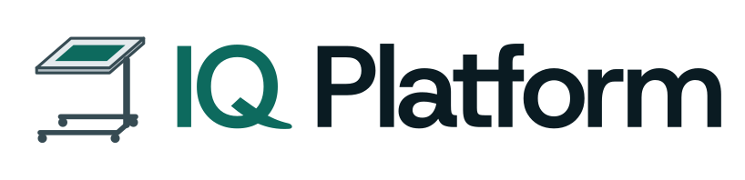
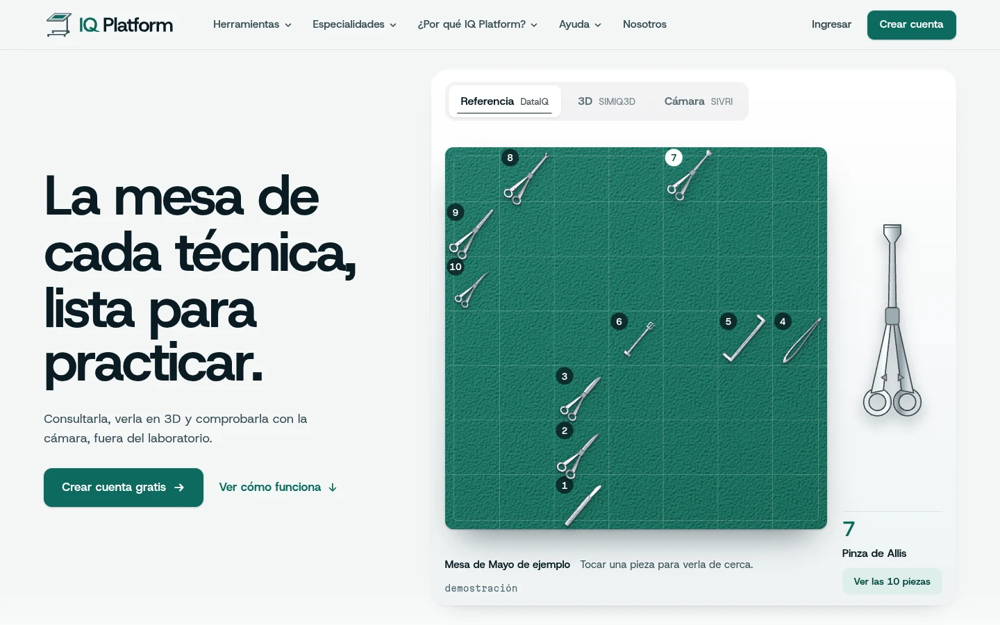
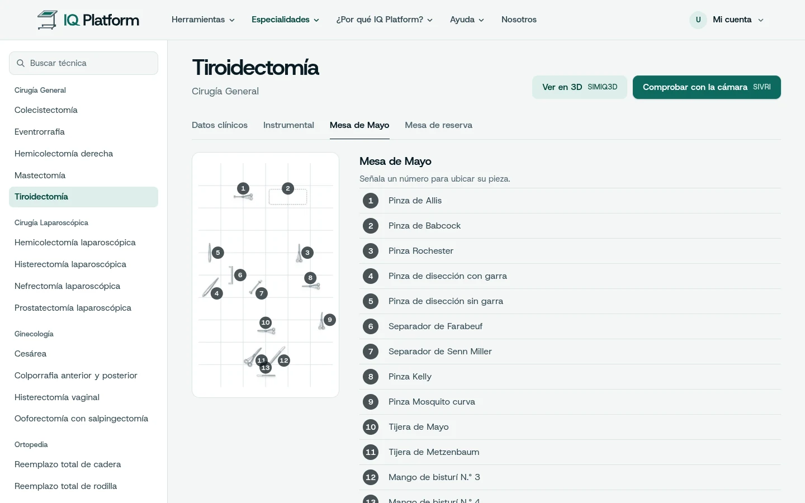
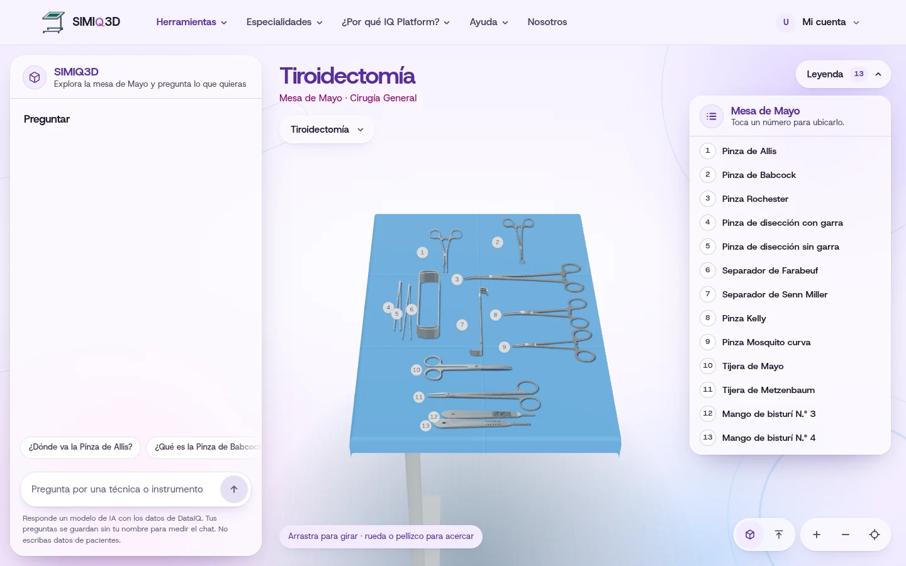
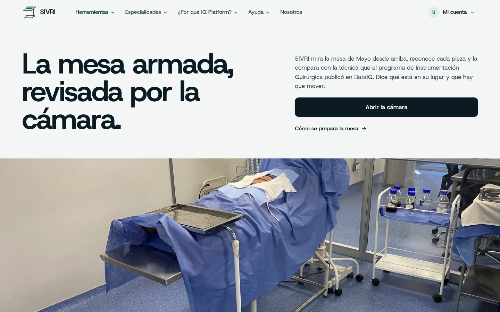
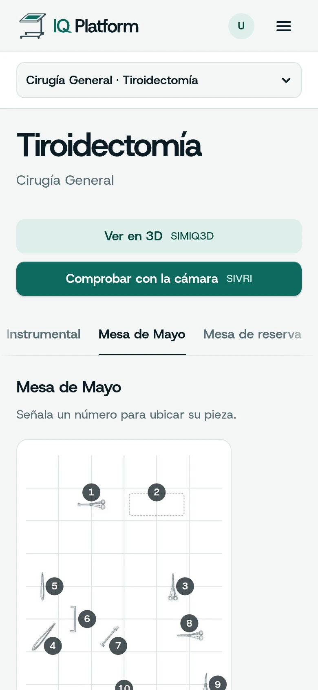
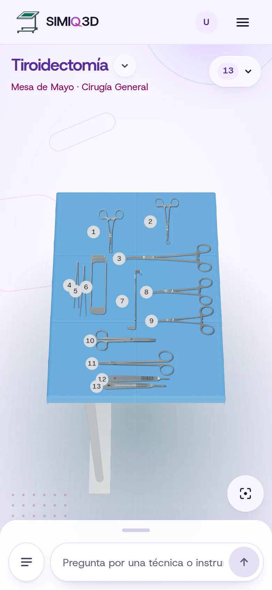
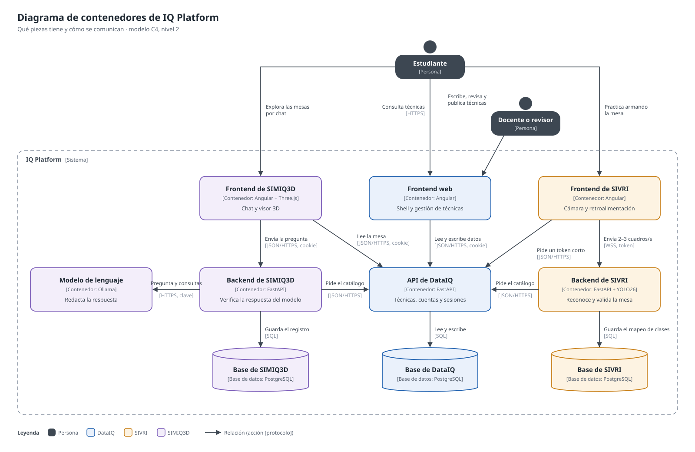

<p align="center">
  <picture>
    <source media="(prefers-color-scheme: dark)" srcset="design/brand/imagotype-compact-dark.svg">
    
  </picture>
</p>

<p align="center">
  <strong>Ecosistema educativo de Instrumentación Quirúrgica</strong><br>
  La mesa de cada técnica: consultarla, verla en 3D y comprobarla con la cámara, fuera del laboratorio.
</p>

<p align="center">
  <a href="https://dataiq-frontend.vercel.app"></a>
  <a href="https://github.com/curn-iq/iq-platform/releases"></a>
  <a href="LICENSE"></a>
  <a href="sivri/LICENSE"></a>
</p>

<p align="center">
  
</p>

**IQ Platform** es un ecosistema educativo para aprender, fuera del
laboratorio, cómo se distribuye el instrumental quirúrgico en la mesa de cada
técnica. Reúne tres herramientas sobre una sola fuente de datos: DataIQ, el
catálogo de técnicas con sus mesas; SIMIQ3D, que muestra la mesa en 3D y
responde preguntas por chat; y SIVRI, que revisa con la cámara del celular una
mesa armada.

Los estudiantes de Instrumentación Quirúrgica practican el armado de la mesa
en el laboratorio, con un docente al lado. Fuera de él no tenían cómo repasar
qué instrumental lleva cada técnica ni cómo saber si una mesa quedó bien
armada.

## Contenido

- [Herramientas](#herramientas)
- [Para quién](#para-quién)
- [Arquitectura](#arquitectura)
- [Stack](#stack)
- [Cómo empezar](#cómo-empezar)
- [Estructura del repositorio](#estructura-del-repositorio)
- [Documentación](#documentación)
- [Estado del proyecto](#estado-del-proyecto)
- [Contribuir](#contribuir)
- [Equipo y agradecimientos](#equipo-y-agradecimientos)
- [Licencia](#licencia)

## Herramientas

### DataIQ: el catálogo de técnicas

[](https://github.com/curn-iq/iq-platform/actions/workflows/dataiq-backend.yml) [](https://github.com/curn-iq/iq-platform/actions/workflows/dataiq-frontend.yml)

Dieciocho técnicas de cinco especialidades, con sus datos clínicos, su
instrumental, sus suturas y equipos, y sus mesas de Mayo y de reserva con cada
objeto numerado en su lugar. Es la fuente única de los datos del ecosistema:
cada versión de una técnica pasa por un revisor antes de publicarse, y SIVRI y
SIMIQ3D la consultan por su API. [Más sobre DataIQ](dataiq/README.md).

<p align="center">
  
</p>

### SIMIQ3D: la mesa en 3D, con chat

[](https://github.com/curn-iq/iq-platform/actions/workflows/simiq3d-backend.yml) [](https://github.com/curn-iq/iq-platform/actions/workflows/simiq3d-frontend.yml)

La mesa de Mayo de cada técnica de Cirugía General en 3D, con modelos del
instrumental hechos sobre fotos de las mesas reales. Se gira, se acerca y se
consulta por chat en lenguaje natural («¿dónde va la Pinza de Allis?»): un
modelo de lenguaje redacta la respuesta y cada frase se revisa contra DataIQ
antes de mostrarse. Es exploración, no evaluación.
[Más sobre SIMIQ3D](simiq3d/README.md).

<p align="center">
  
</p>

### SIVRI: la mesa armada, revisada por la cámara

[](https://github.com/curn-iq/iq-platform/actions/workflows/sivri-backend.yml) [](https://github.com/curn-iq/iq-platform/actions/workflows/sivri-frontend.yml)

El estudiante apunta la cámara del celular a la mesa de Mayo que armó. Un
detector YOLO26 reconoce cada instrumento, SIVRI identifica la técnica y dice
qué está en su lugar, qué hay que mover y a dónde, qué falta y qué sobra.
Las imágenes se procesan y no se guardan. [Más sobre SIVRI](sivri/README.md).

<p align="center">
  
</p>

### En el celular

Todo funciona en computador y en celular por igual.

<p align="center">
  
  &nbsp;&nbsp;
  
</p>

## Para quién

- **Estudiantes de Instrumentación Quirúrgica**, el usuario principal, de la
  CURN o de cualquier institución: repasan qué instrumental lleva cada técnica
  y dónde va cada objeto en la mesa.
- **Revisores** (docentes e instrumentadores titulados): aprueban o rechazan
  las versiones de las técnicas y mantienen el catálogo de instrumental.
- **Colaboradores**: crean técnicas y editan versiones en borrador. La
  **administración** asigna los roles. Detalle en [`docs/flujos.md`](docs/flujos.md).

El catálogo y los datos clínicos son públicos; el instrumental, las mesas y
las herramientas piden una cuenta gratuita.

**Principios del producto:**

1. **La fuente manda.** Lo que se muestra viene de los documentos del programa
   de Instrumentación Quirúrgica y se puede rastrear; lo que falta se dice, no
   se rellena.
2. **La mesa es el centro.** Todo camino lleva a ver dónde va cada objeto y
   qué es.
3. **Leer es fácil, publicar es cuidadoso.** El catálogo está a un clic; la
   publicación siempre pasa por un revisor.
4. **Primero la CURN, abierta a cualquier estudiante.** Se construye para el
   programa de la CURN; cualquier estudiante puede crear su cuenta y usarla.
5. **Liviano.** Funciona bien en celular y en equipos modestos.

Cómo se ve y cómo habla la plataforma: [`design/README.md`](design/README.md).

## Arquitectura

Cada herramienta es un módulo independiente, con su propio backend y su propia
base de datos:

- Las bases de datos de los módulos nunca se comunican entre sí.
- SIVRI y SIMIQ3D obtienen los datos de DataIQ únicamente por HTTPS a su API.
- DataIQ emite las sesiones (JWT firmados con EdDSA); los demás módulos solo
  validan su firma con la clave pública.

<p align="center">
  
</p>

Infraestructura, despliegue y el porqué de cada decisión:
[`docs/arquitectura.md`](docs/arquitectura.md).

## Stack

| Capa | Tecnología |
|---|---|
| Frontends | Angular (el shell y DataIQ, SIMIQ3D con Three.js, SIVRI), en Vercel |
| Backends | Python con FastAPI, arquitectura hexagonal, SQLAlchemy y Alembic |
| Bases de datos | PostgreSQL 18, una por módulo (DataIQ y SIMIQ3D en Neon; SIVRI en su servidor) |
| Autenticación | JWT con EdDSA emitido por DataIQ; contraseñas con Argon2id |
| Visión artificial (SIVRI) | YOLO26 de Ultralytics, OpenCV con marcadores ArUco |
| Modelo de lenguaje (SIMIQ3D) | Qwen3-VL 8B con Ollama, en un servidor propio |
| Modelos 3D (SIMIQ3D) | Blender, exportados a GLB |

## Cómo empezar

La plataforma está en <https://dataiq-frontend.vercel.app>.

Para correrla en local hacen falta [uv](https://docs.astral.sh/uv/), Python
3.14, Node.js 24 y Podman (o Docker). DataIQ es la base de todo: los demás
módulos lo necesitan corriendo.

```sh
# 1. Base de datos de DataIQ (PostgreSQL 18)
podman run -d --name dataiq-db -p 5432:5432 \
  -e POSTGRES_USER=dataiq -e POSTGRES_PASSWORD=<contraseña> -e POSTGRES_DB=dataiq \
  -v dataiq-db-datos:/var/lib/postgresql docker.io/library/postgres:18

# 2. API de DataIQ (copiar antes .env.example a .env y llenarlo)
cd dataiq/backend
uv run alembic upgrade head
uv run python -m seed.load
uv run fastapi dev app/main.py        # http://127.0.0.1:8000/docs

# 3. Frontend (en otra terminal)
cd dataiq/frontend
npm ci
npm start                             # http://localhost:4200
```

Cómo se corren SIMIQ3D y SIVRI, sus servidores y las pruebas: el README de
cada módulo ([DataIQ](dataiq/README.md), [SIMIQ3D](simiq3d/README.md),
[SIVRI](sivri/README.md)).

## Estructura del repositorio

```
iq-platform/
├── dataiq/
│   ├── backend/         API, esquema y carga del catálogo
│   ├── frontend/        Angular: el shell de navegación y DataIQ
│   └── docs/            esquema de la base y checklists
├── simiq3d/
│   ├── backend/         el chat y el mapeo de los modelos
│   ├── frontend/        Angular y Three.js
│   ├── models/          modelos 3D (.blend, GLB y medidas)
│   ├── servidor-pc2/    el filtro del modelo de lenguaje
│   └── docs/
├── sivri/
│   ├── backend/         detector, validación de la mesa y su base
│   ├── frontend/        la cámara del celular
│   ├── servidor-pc1/    el servidor del detector
│   └── docs/            dataset y checklists
├── shared/              la barra superior y los tokens visuales comunes
├── design/              sistema de diseño y marca
└── docs/                arquitectura, flujos, privacidad, diagramas e imágenes
```

## Documentación

- Arquitectura e infraestructura: [`docs/arquitectura.md`](docs/arquitectura.md).
- Roles y flujos: [`docs/flujos.md`](docs/flujos.md).
- Aviso de privacidad: [`docs/privacidad.md`](docs/privacidad.md).
- Lo que queda para después del MVP: [`docs/despues-del-mvp.md`](docs/despues-del-mvp.md).
- Sistema de diseño y marca: [`design/README.md`](design/README.md); las
  pantallas se diseñan en el [Figma del proyecto](https://www.figma.com/design/jHEduZTQNBs4CCJEWB8u5v/).
- Qué cambió en cada versión: [Releases](https://github.com/curn-iq/iq-platform/releases).
- Instrucciones para asistentes de código: [`CLAUDE.md`](CLAUDE.md) y
  [`.claude/rules/`](.claude/rules/).

## Estado del proyecto

El MVP está en producción: las 18 técnicas en DataIQ y la mesa de Mayo de las
cinco técnicas de Cirugía General en SIMIQ3D y SIVRI. Es una fase preliminar:
se evalúa con el programa de Instrumentación Quirúrgica, con la Escala de Usabilidad del Sistema (SUS) y
una prueba piloto. Después, SIVRI y SIMIQ3D se rehacen con fotos propias de
todo el instrumental ([`docs/despues-del-mvp.md`](docs/despues-del-mvp.md)) y
la plataforma se abre a los estudiantes.

## Contribuir

Cómo se trabaja en el repositorio (ramas, commits, PR, pruebas y releases):
[`CONTRIBUTING.md`](CONTRIBUTING.md). Para reportar un problema, abrir un
[issue](https://github.com/curn-iq/iq-platform/issues).

## Equipo y agradecimientos

IQ Platform nació como trabajo de grado del programa de Ingeniería de Sistemas
de la Corporación Universitaria Rafael Núñez (CURN), Cartagena, Colombia,
desarrollado por Juan José Caraballo Nieves, Guebriel Gabriel Garcés Ravel y
Mauricio José Lugo Granados, con la dirección de Yair Fernando Cardona Acuña.

Gracias a las estudiantes del programa de Instrumentación Quirúrgica de la
CURN y a su docente tutora, que aportaron los documentos de las técnicas y
armaron en el laboratorio las mesas que se fotografiaron.

Para citar este software, ver [`CITATION.cff`](CITATION.cff) o el botón
«Cite this repository» de GitHub.

## Licencia

[MIT](LICENSE), salvo `sivri/`, que va con [AGPL-3.0](sivri/LICENSE) porque usa
YOLO26 de Ultralytics. SIVRI es un programa aparte que se comunica con DataIQ
por HTTP: la AGPL no se extiende al resto del repositorio (detalle en
[`sivri/README.md`](sivri/README.md), «Licencia»).
