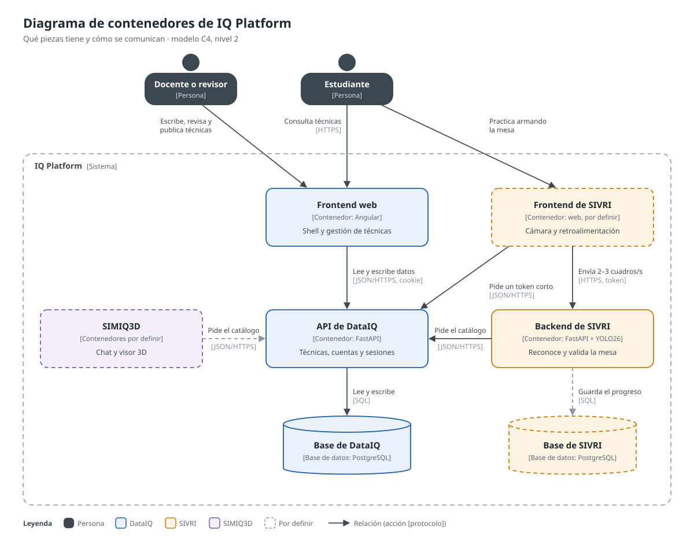
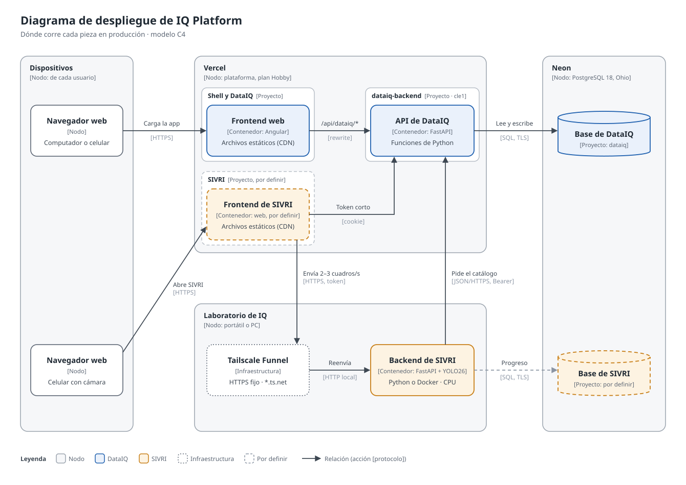

# Arquitectura de IQ Platform

Diagramas del ecosistema, con el [modelo C4](https://c4model.com/): cada uno
es de un solo tipo y se entiende sin leer el texto. Son SVG en
[`diagramas/`](diagramas/): se editan como texto, se actualizan en el mismo PR
que cambia lo que muestran y se pueden pegar tal cual como figuras en el
Formato 115.

## Contenedores



Qué piezas tiene el sistema y cómo se comunican, sin importar dónde corren:

- El **frontend web** (Angular) reúne el shell y la gestión de técnicas; lee y
  escribe por la **API de DataIQ** con la cookie de sesión.
- La **API de DataIQ** es la única que toca la base de DataIQ y la única que
  emite tokens. SIVRI y SIMIQ3D le piden el catálogo por HTTPS; nunca entran a
  su base.
- El **frontend de SIVRI** pide a DataIQ un token corto y con él envía 2 o 3
  cuadros por segundo de la cámara al **backend de SIVRI**, que reconoce el
  instrumental y valida la mesa.
- El **frontend de SIMIQ3D** (Angular y Three.js) envía la pregunta del chat a
  su **backend**, con las anteriores de la conversación. El backend pide el
  catálogo a DataIQ; el **modelo de lenguaje** convierte la pregunta en
  pedidos (dónde va un instrumento, un dato clínico, la mesa…); el backend
  responde cada uno con datos de DataIQ, el modelo redacta la respuesta solo
  con esos datos, y el backend la verifica antes de enviarla y guarda el
  registro de la conversación en su base.
  Con la respuesta, el frontend lee la mesa directo de la **API de DataIQ** y
  arma la escena.

## Despliegue



Dónde corre cada pieza en producción y cómo llega ahí:

- **Vercel** (plan Hobby) tiene un proyecto por pieza que se despliega aparte:
  el del shell y DataIQ (`dataiq-frontend`) sirve el frontend web, el de SIVRI
  su frontend, los de SIMIQ3D su frontend (`simiq3d-frontend`, un sitio estático) y su backend
  (`simiq3d-backend`), y `dataiq-backend` la API, los dos backends como
  funciones de Python en la región `cle1`. El navegador llega a la API por un rewrite
  del mismo dominio (`/api/dataiq/*`), así que la cookie de sesión viaja sin
  CORS. Los frontends de SIMIQ3D y SIVRI también se abren por ese dominio,
  con rewrites del proyecto del shell (`/simiq3d/*` y `/sivri/*`) hacia el
  de cada módulo, para que lleguen con la misma cookie.
- **Neon** guarda una base por módulo (PostgreSQL 18, Ohio), cada una en su
  propio proyecto.
- **El backend de SIVRI** corre en el **Servidor PC1**, un PC del laboratorio,
  durante las sesiones. Tailscale Funnel le da una dirección HTTPS fija y le
  reenvía lo que manda el celular; el servidor pide el catálogo a DataIQ una
  vez por sesión.
- **El modelo de lenguaje de SIMIQ3D** corre con Ollama en el **Servidor
  PC2**, un PC de escritorio con GPU, detrás de Tailscale Funnel y de un
  filtro con clave. Si el Servidor PC2 se apaga, solo deja de funcionar el
  chat.
- **GitHub Actions** lleva el código a producción: en cada push a `main`
  despliega en Vercel. También publica la imagen del backend de DataIQ en
  ghcr.io, que producción no usa (Vercel construye desde el código): sirve
  para correrlo fuera de Vercel, por ejemplo en Cloud Run si la institución
  lo financia ([`despues-del-mvp.md`](despues-del-mvp.md)).

## Por qué así

Decidido por Mauricio el 2026-10-14: solo servicios gratuitos que no exigen
tarjeta de crédito, porque el equipo no dispone de recursos para prepagar un
servicio en la nube. Límites verificados en la documentación oficial de cada
proveedor en octubre de 2026.

| Pieza | Servicio | Por qué y con qué límites |
|---|---|---|
| Backends de DataIQ y SIMIQ3D | Vercel Hobby, funciones de Python (región `cle1`, junto a Neon) | Cupo mensual de la cuenta: 4 horas de CPU activa (la espera por la base de datos no cuenta), 1 millón de invocaciones y 100 GB de transferencia. Escala a cero; el arranque en frío tarda segundos. Con `DATABASE_POOL=false`, cada función abre y cierra su conexión para no acumular conexiones en Neon. Hobby es solo para uso no comercial (un proyecto de grado cumple) y de una sola persona: los proyectos están en la cuenta de Mauricio |
| Frontends | Vercel Hobby (100 GB de transferencia al mes, que comparten los rewrites hacia las APIs) | Hobby no conecta un proyecto a un repositorio de una organización de GitHub: se despliega con el CLI de Vercel desde GitHub Actions, con el secreto `VERCEL_TOKEN` |
| Bases de datos | Neon Free, un proyecto por módulo (región `aws-us-east-2`, Ohio: no hay región en Sudamérica) | 0,5 GB de almacenamiento, 100 CU-hora y 5 GB de transferencia al mes por proyecto, con scale-to-zero. Al pasar el plan no se cobra: el cómputo se suspende hasta el ciclo siguiente, y por encima de 0,5 GB fallan las escrituras |
| Backend de SIVRI | Servidor PC1: un PC del laboratorio con Tailscale Funnel (dirección HTTPS fija `*.ts.net`, plan gratuito) | SIVRI se usa en sesiones de laboratorio, y ningún servicio gratuito sin tarjeta ofrece CPU sostenida para YOLO. Detalle: [`sivri/docs/checklist.md`](../sivri/docs/checklist.md) |
| Modelo de lenguaje de SIMIQ3D | Servidor PC2: un PC de escritorio con GPU, con Ollama y Tailscale Funnel, detrás de un filtro con clave | Si el Servidor PC2 se apaga, solo deja de funcionar el chat. Detalle: [`simiq3d/servidor-pc2/README.md`](../simiq3d/servidor-pc2/README.md) |
| Imagen del backend de DataIQ | GitHub Container Registry (ghcr.io), pública | Vercel no la usa; sirve para correr el backend fuera de Vercel |
| CI/CD | GitHub Actions | En cada PR, estilo y pruebas; en cada push a `main`, despliegue a Vercel e imagen a ghcr.io. No hay rama `dev`: `main` es producción y nada entra sin PR y CI. Las previews por PR, con una rama `dev` de la base en Neon, se agregan cuando haya usuarios que proteger |

Se descartaron:

- **Google Cloud Run:** en Colombia, crear la cuenta de facturación exige un
  prepago de COP 100.000. Queda como opción si la institución lo financia
  ([`despues-del-mvp.md`](despues-del-mvp.md)).
- **Azure for Students:** regiones restringidas por suscripción.
- **Render y similares:** 512 MB y 0,1 CPU, se suspenden por inactividad y
  pueden exigir tarjeta.
- **Hugging Face Spaces:** su cómputo gratuito no sirve para SIVRI.
- **El crédito de GCP de USD 300 por 90 días:** vence.
- **Oracle Cloud y Koyeb:** exigen tarjeta.

## Límite de intentos de autenticación

Decidido por Mauricio Lugo el 2026-11-01, para cumplir el nivel 1 de
[OWASP ASVS 5.0](https://github.com/OWASP/ASVS/blob/master/5.0/en/0x15-V6-Authentication.md)
en autenticación: el requisito 6.1.1 pide documentar cómo se frena la prueba
masiva de contraseñas y cómo eso evita bloquear la cuenta de otra persona, y
el 6.3.1, aplicarlo. Se hace con una regla de rate limiting del firewall de
Vercel en el proyecto `dataiq-backend`, incluida en el plan Hobby (una regla
por proyecto y 1.000.000 de solicitudes permitidas; verificado en la
documentación de Vercel el 2026-11-01). No necesita código.

- **Qué cuenta:** las peticiones `POST` a `/auth/login`, `/auth/register` y
  `/auth/token`, por IP, en una ventana fija de 10 minutos (el máximo de
  Hobby).
- **Cuánto:** 100 peticiones por IP en cada ventana. Desde la 101, el
  firewall responde 429 sin llegar a la función, hasta que empieza la ventana
  siguiente.
- **Por qué 100:** un curso en una sala de la CURN sale a internet con una
  sola IP, y un límite bajo bloquearía la clase entera. 100 en 10 minutos deja
  ingresar y registrarse a un curso, y frena la prueba masiva de contraseñas y
  de correos.
- **Sin bloquear cuentas:** el contador es por IP, no por cuenta, así que
  nadie puede bloquear la cuenta de otra persona; quien pasa el límite espera
  a la ventana siguiente.
- **Dónde va:** en el proyecto del backend, porque ahí llega quien llama a la
  API directo y también lo que pasa por el rewrite del shell. Vercel reemplaza
  `X-Forwarded-For` en lo que le llega desde otro proxy
  ([encabezados de la petición](https://vercel.com/docs/headers/request-headers)),
  así que había que comprobar que lo que llega por el shell trae la IP del
  navegador y no la de Vercel; si no, todas las personas contarían como una.
  Se comprobó el 2026-11-02 con dos peticiones marcadas, una directa al
  backend y otra por el shell: en los registros de peticiones de
  `dataiq-backend` (`vercel logs requests`), las dos llegaron con el país de
  la IP de origen (Colombia) y no con el del servidor de Vercel que hace el
  rewrite (Estados Unidos). Si eso cambiara, la regla se pasa al proyecto del
  shell (ruta `/api/dataiq/auth/…`).

La regla vive en Vercel, no en el repo. Este comando la crea igual, con el CLI
de Vercel y la cuenta de Mauricio; `firewall diff` muestra el cambio y
`firewall publish` lo aplica:

```sh
npx --yes vercel@64.0.2 firewall rules add "Límite de intentos de autenticación" \
  --project dataiq-backend \
  --condition '{"type":"method","op":"eq","value":"POST"}' \
  --condition '{"type":"path","op":"inc","value":["/auth/login","/auth/register","/auth/token"]}' \
  --action rate_limit --rate-limit-window 600 --rate-limit-requests 100 \
  --rate-limit-keys ip --rate-limit-action rate_limit --yes
npx --yes vercel@64.0.2 firewall diff --project dataiq-backend
npx --yes vercel@64.0.2 firewall publish --project dataiq-backend --yes
```
