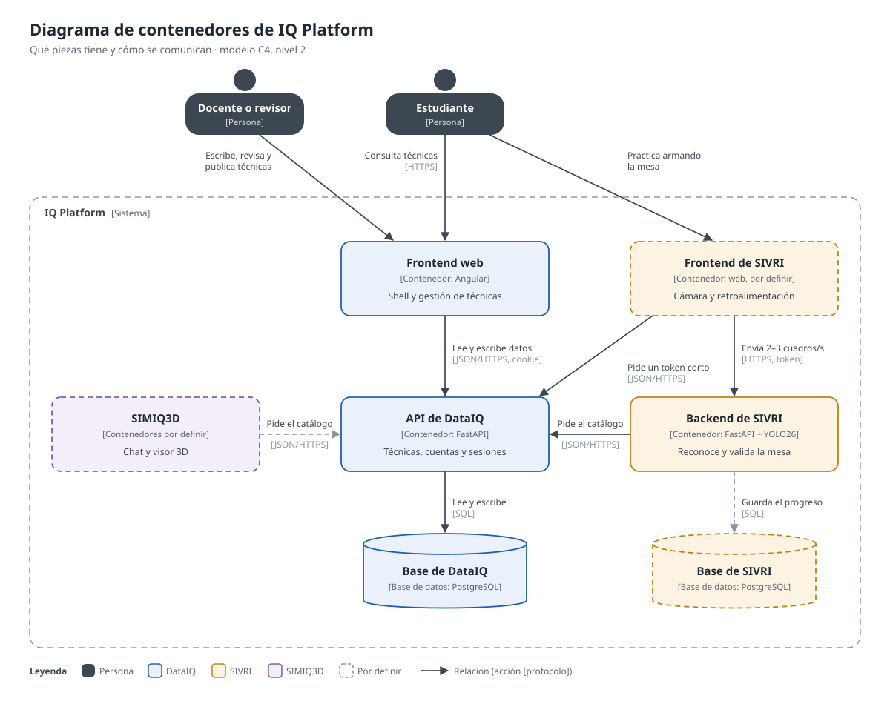
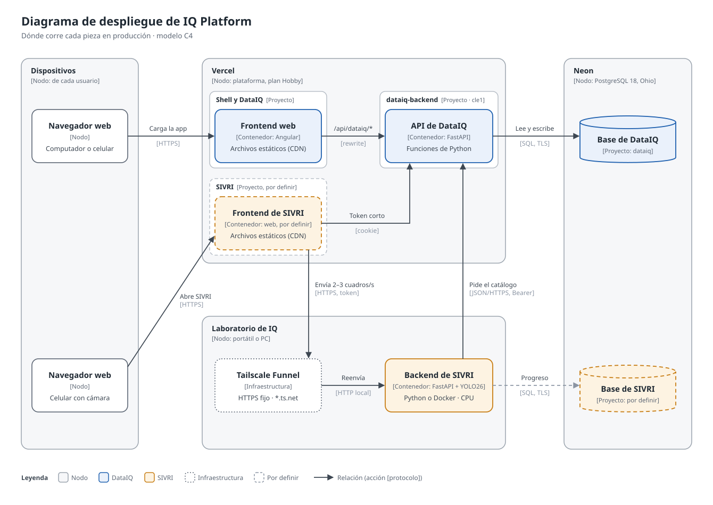

# Arquitectura de IQ Platform

Diagramas del ecosistema, con el [modelo C4](https://c4model.com/): cada uno
es de un solo tipo y se entiende sin leer el texto. Son SVG en
[`diagramas/`](diagramas/): se editan como texto, se actualizan en el mismo PR
que cambia lo que muestran y se pueden pegar tal cual como figuras en el
Formato 115.

## Contenedores

Qué piezas tiene el sistema y cómo se comunican, sin importar dónde corren:

- El **frontend web** (Angular) reúne el shell y la gestión de técnicas; lee y
  escribe por la **API de DataIQ** con la cookie de sesión.
- La **API de DataIQ** es la única que toca la base de DataIQ y la única que
  emite tokens. SIVRI y SIMIQ3D le piden el catálogo por HTTPS; nunca entran a
  su base.
- El **frontend de SIVRI** pide a DataIQ un token corto y con él envía 2 o 3
  cuadros por segundo de la cámara al **backend de SIVRI**, que reconoce el
  instrumental y valida la mesa.
- El **frontend de SIMIQ3D** (Angular y Three.js) envía la pregunta del chat a
  su **backend**. El backend pide el catálogo a DataIQ y deja que el **modelo
  de lenguaje** lo consulte (técnicas, instrumentos, comparar mesas) y redacte
  la respuesta; antes de enviarla verifica que cada nombre, número y ubicación
  esté en lo consultado, y guarda el registro de la conversación en su base.
  Con la respuesta, el frontend lee la mesa directo de la **API de DataIQ** y
  arma la escena.

## Despliegue

Dónde corre cada pieza en producción y cómo llega ahí:

- **Vercel** (plan Hobby) tiene un proyecto por pieza que se despliega aparte:
  el del shell y DataIQ sirve el frontend web, el de SIVRI su frontend, el de
  SIMIQ3D su frontend y su backend, y `dataiq-backend` la API como funciones
  de Python en la región `cle1`. El navegador llega a la API por un rewrite
  del mismo dominio (`/api/dataiq/*`), así que la cookie de sesión viaja sin
  CORS. Los frontends de SIMIQ3D y SIVRI también se abren por ese dominio,
  con rewrites del proyecto del shell (`/simiq3d/*` y `/sivri/*`) hacia el
  de cada módulo, para que lleguen con la misma cookie.
- **Neon** guarda una base por módulo (PostgreSQL 18, Ohio), cada una en su
  propio proyecto.
- **El backend de SIVRI** corre en el **Servidor PC1**, un PC del laboratorio,
  durante las sesiones. Tailscale Funnel le da una dirección HTTPS fija y le
  reenvía lo que manda el celular; el servidor pide el catálogo a DataIQ una
  vez por sesión.
- **El modelo de lenguaje de SIMIQ3D** corre con Ollama en el **Servidor
  PC2**, un PC de escritorio con GPU, detrás de Tailscale Funnel y de un
  filtro con clave. Si el Servidor PC2 se apaga, solo deja de funcionar el
  chat.
- **GitHub Actions** lleva el código a producción: en cada push a `main`
  despliega en Vercel. También publica la imagen del backend de DataIQ en
  ghcr.io, que producción no usa (Vercel construye desde el código): sirve
  para correrlo fuera de Vercel, por ejemplo en Cloud Run si la institución
  lo financia ([`despues-del-mvp.md`](despues-del-mvp.md)).

El porqué de cada elección y lo que se descartó está en `CLAUDE.md`
(«Infraestructura de despliegue»).
