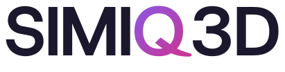

  <picture>
    <source media="(prefers-color-scheme: dark)" srcset="../design/brand/modules/simiq3d-dark.svg">
    
  </picture>

La mesa de Mayo de cada técnica en 3D, con un chat. El estudiante pregunta en
lenguaje natural («¿dónde va la Pinza de Allis?») y el visor le muestra la mesa
con el instrumental en su lugar, que puede girar y acercar. Es exploración y
consulta, no evaluación: la práctica con retroalimentación es de SIVRI.
SIMIQ3D toma sus datos de DataIQ.

## Qué hace

- **Visor 3D** de la mesa de Mayo de las cinco técnicas de Cirugía General,
  con 16 modelos del instrumental hechos sobre fotos de las mesas reales, cada
  uno en la posición que guarda DataIQ.
- **Chat tutor:** el código decide de qué se habla y trae los datos de DataIQ;
  un modelo de lenguaje redacta la respuesta y cada frase se revisa contra
  DataIQ antes de mostrarse. No ordena la mesa por tiempos quirúrgicos ni da
  dosis.
- **Registro anónimo de las preguntas**, para medir la exactitud del chat; no
  guarda quién pregunta.

## Partes

| Carpeta | Qué es |
|---|---|
| [`backend/`](backend/README.md) | La API del chat (FastAPI) y el mapeo de los modelos 3D |
| [`frontend/`](frontend/README.md) | La app (Angular y Three.js): el visor y el chat |
| [`models/`](models/README.md) | Los modelos 3D del instrumental (.blend, GLB y medidas) |
| [`servidor-pc2/`](servidor-pc2/README.md) | El servidor del modelo de lenguaje (Ollama y su filtro) |
| [`docs/`](docs/) | Decisiones, el chat, el frontend por dentro, esquema y checklists |

## Documentación

- Alcance del MVP, stack y cómo se evalúa: [`docs/decisiones.md`](docs/decisiones.md).
- El chat, sus límites y su porqué: [`docs/chat.md`](docs/chat.md).
- El frontend por dentro y cómo se arma la mesa en 3D: [`docs/frontend.md`](docs/frontend.md).
- Esquema de la base: [`docs/esquema.dbml`](docs/esquema.dbml).
- Avance: [`docs/checklist.md`](docs/checklist.md) (por actividad de DSRM),
  [`docs/checklist-backend.md`](docs/checklist-backend.md) y
  [`docs/checklist-frontend.md`](docs/checklist-frontend.md).

## Licencia

[MIT](../LICENSE).
