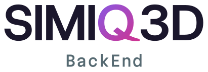

<p align="center">
  <picture>
    <source media="(prefers-color-scheme: dark)" srcset="../../design/brand/modules/simiq3d-backend-dark.svg">
    
  </picture>
</p>


La API del chat de SIMIQ3D: recibe la pregunta del estudiante, la responde con
datos del catálogo de DataIQ y le dice al visor qué mostrar. También entrega
qué modelo 3D dibuja cada instrumento. En producción:
<https://simiq3d-backend.vercel.app>.

## Stack

| | |
|---|---|
| API | Python 3.14 y FastAPI, con arquitectura hexagonal (`domain/`, `ports/`, `adapters/`), como DataIQ |
| Base | PostgreSQL 18, su propio proyecto en Neon; SQLAlchemy async y Alembic. Esquema: [`../docs/esquema.dbml`](../docs/esquema.dbml) |
| Sesión | El JWT de DataIQ, validado con su clave pública (JWKS); SIMIQ3D no tiene usuarios |
| Modelo de lenguaje | Ollama en el Servidor PC2 (por defecto, `qwen3-vl:8b-instruct`), por su API compatible con OpenAI |

## Correrlo

Hace falta [uv](https://docs.astral.sh/uv/), Podman (o Docker) y el backend de
DataIQ corriendo (ver [`../../dataiq/backend/README.md`](../../dataiq/backend/README.md#correrlo)). Todo
se corre desde `simiq3d/backend`.

1. PostgreSQL 18 en un contenedor propio, aparte del de DataIQ:

   ```sh
   podman run -d --name simiq3d-db -p 5433:5432 \
     -e POSTGRES_USER=simiq3d -e POSTGRES_PASSWORD=<contraseña> -e POSTGRES_DB=simiq3d \
     -v simiq3d-db-datos:/var/lib/postgresql docker.io/library/postgres:18
   ```

2. Copiar `.env.example` a `.env` y poner la URL de esa base.
3. Crear las tablas y levantar la API:

   ```sh
   uv run alembic upgrade head
   uv run fastapi dev app/main.py --port 8001
   ```

   La documentación interactiva queda en http://127.0.0.1:8001/docs. Para
   «Authorize» hace falta un token de DataIQ (`POST /auth/token` de su API);
   en local sirven sus cuentas de desarrollo, como `admin@example.com` con la
   contraseña `desarrollo`.

4. Con el modelo de lenguaje: instalar [Ollama](https://ollama.com), bajar el
   modelo y ponerlo en el `.env`:

   ```sh
   ollama pull qwen3-vl:8b-instruct
   ```

   ```
   LANGUAGE_MODEL=ollama
   LLM_MODEL=qwen3-vl:8b-instruct
   ```

   Sin eso responde el motor de plantillas (`LANGUAGE_MODEL=fake`), que no
   necesita el modelo. Con el modelo responde el tutor.

## Pruebas

```sh
uv run pytest
uv run ruff check . && uv run ruff format --check .
```

Las pruebas usan su propia base (`simiq3d_test`) en el mismo servidor y un
DataIQ y un Ollama falsos: no necesitan nada más corriendo.

## API

| Ruta | Qué hace | Pide cuenta |
|---|---|---|
| `POST /chat` | Responde una pregunta, todo junto | Sí (y `X-IQ-Client` si llega con cookie) |
| `POST /chat/stream` | Lo mismo, a medida que se escribe (NDJSON) | Sí (y `X-IQ-Client` si llega con cookie) |
| `GET /models` | Qué GLB dibuja cada instrumento (`instrument_id`, `model_file`), con `ETag` | Sí |
| `GET /health` | Si la API está arriba | No |

`POST /chat` recibe `{"question", "technique_id", "previous"}`:
`technique_id` es la técnica abierta en el visor (opcional), y `previous`,
hasta 3 preguntas anteriores de la conversación, de la más antigua a la más
reciente, cada una con los `requests` y el texto (`reply`) de su respuesta
(opcional; no se guardan). Devuelve:

```json
{
  "action": "highlight_instrument",
  "technique_id": "…",
  "instrument_id": "…",
  "field": null,
  "reply": "La **Pinza Kelly** va en el centro de la mesa de Mayo de la colecistectomía, junto a la Tijera de Mayo: es el n.º 10 del diagrama.",
  "generated": true,
  "options": ["¿Qué es la Pinza Kelly?"],
  "requests": [{"kind": "locate", "technique": "Colecistectomía", "instrument": "Pinza Kelly", "field": null, "other_technique": null, "comparison": null, "topic": null}]
}
```

`reply` viene en Markdown sencillo (párrafos, `**negrita**` y listas con «- » o
«1. »), y `generated` dice si lo escribió el modelo: el frontend muestra
entonces de dónde sale cada cosa.

| `action` | Qué hace el visor |
|---|---|
| `show_technique` | Abre la técnica (`technique_id`) |
| `highlight_instrument` | Abre la técnica y resalta el instrumento (`instrument_id`) |
| `show_clinical_data`, `list_instruments`, `describe_instrument` | Abre la técnica, si viene; el texto trae el dato |
| `answer` | Nada: es una respuesta en texto («¿en cuántas técnicas…?») |
| `clarify` | Nada: pide precisar (en qué técnica, o «¿Quizás quisiste decir…?»); las `options` son las preguntas para elegir. Solo con las reglas fijas |
| `no_answer` | Nada: la pregunta no trata de estas técnicas. Solo con las reglas fijas |

`options` son preguntas que se pueden mandar tal cual como la siguiente.
`requests` dicen de qué se habló (ver «Cómo responde el chat»): el frontend
los manda de vuelta en `previous` con la siguiente. Errores: `401` sin sesión o
si DataIQ rechaza el token; `429` si la cuenta pasó el tope de preguntas (por
defecto, 30 cada 10 minutos: «Espera unos minutos»); `503` si DataIQ no
responde. Si el Servidor PC2 no responde, no hay error: el tutor dice que el
modelo no está disponible y muestra lo que DataIQ tiene de lo que se nombró.

`POST /chat/stream` recibe lo mismo y responde `application/x-ndjson`, una
línea JSON por evento: `{"type": "start", …}` con los campos de `ChatOut` y
`reply` vacío (lo que hace el visor), cada `{"type": "text", "text": "…"}` (una
parte ya revisada, que se agrega a lo mostrado, con sus espacios y saltos de
línea) y `{"type": "end", …}` con la respuesta completa. Los errores antes de
empezar (`401`, `429`, `503` de DataIQ) son los de `POST /chat`. Con las
plantillas, los tres eventos llegan juntos.

## Qué guarda

El backend corre en Vercel (ver [`../docs/chat.md`](../docs/chat.md)) y
tiene su propia base en Neon, en un proyecto aparte, como cada módulo:

| Qué | Dónde | Por qué |
|---|---|---|
| Mapeo de cada modelo 3D a su instrumento de DataIQ (`instruments.id`) | Base de SIMIQ3D | Ese mapeo es de SIMIQ3D, no de DataIQ, como las clases de YOLO en SIVRI. Los ids del catálogo cambian de una instalación a otra: el repo guarda el mapeo por nombre del instrumento (o un alias) y un comando lo traduce a ids en cada entorno con la API de DataIQ |
| Registro de las conversaciones: pregunta, acción elegida por el modelo y fecha | Base de SIMIQ3D | Sin él no hay cómo demostrar con números que el chat funciona (ver abajo) |
| Contador de preguntas por cuenta, con el id cifrado (HMAC), por unos minutos | Base de SIMIQ3D | Que nadie llene de consultas el Servidor PC2; no deja saber de quién es y se borra al día |
| Archivos de los modelos (GLB) | Archivos estáticos del frontend, en Vercel | Se descargan una vez y quedan en caché; en Neon gastarían su medio GB |
| Técnicas e instrumentos que el chat le ofrece al modelo | DataIQ, por `/catalog/full`, que el backend cachea por sesión | DataIQ es la única fuente de verdad |
| La mesa que dibuja el visor y la descripción de cada instrumento | DataIQ, que el frontend lee directo (`GET /techniques/{id}/instruments`, `GET /instruments`) | No pasa por el backend de SIMIQ3D: sería un salto más sin aportar nada, y el visor sigue funcionando sin el chat |

El registro de conversaciones:

- **Sin datos de quién pregunta**: no guarda la cuenta ni nada que identifique
  a la persona.
- Está encendido mientras dura el proyecto: mide la exactitud con preguntas reales, no solo con las de las
  sesiones de evaluación. En la prueba piloto, los participantes además dan su
  consentimiento informado (Resolución 8430 de 1993).
- Al cerrar la evaluación sumativa se exporta lo que necesita el informe, se
  borra y se apaga (`CHAT_LOG_ENABLED=false`): los datos se guardan solo
  mientras sirven a su finalidad (Decreto 1377 de 2013, art. 11). Se vuelve a
  encender solo si la política declara una finalidad nueva.
- La pregunta es texto libre y podría traer datos de un paciente, que son
  datos sensibles (Ley 1581 de 2012, art. 5). Por eso el frontend avisa bajo el
  campo del chat: «Tus preguntas se guardan sin tu nombre para medir el chat.
  No escribas datos de pacientes».
- El [aviso de privacidad](../../docs/privacidad.md) lo declara, con su
  finalidad (Ley 1581 de 2012): es condición para abrir la plataforma a los
  estudiantes.

## Comandos

```sh
# Mapeo de modelos 3D: lee ../models/modelos.csv (columnas instrumento y archivo)
uv run python -m app.adapters.inbound.cli.load_models

# Registro de conversaciones (se apaga con CHAT_LOG_ENABLED=false). Con --desde
# y --hasta (hora de Colombia), solo las preguntas de una sesión de evaluación
uv run python -m app.adapters.inbound.cli.chat_log exportar registro.csv
uv run python -m app.adapters.inbound.cli.chat_log exportar sesion.csv \
    --desde 2026-11-02T14:30 --hasta 2026-11-02T17:00
uv run python -m app.adapters.inbound.cli.chat_log borrar

# Banco de preguntas: corre eval/banco.csv contra el chat y mide su exactitud
uv run python -m app.adapters.inbound.cli.chat_bank --salida resultados.csv
# Con --fidelidad, el modelo revisa además cada frase redactada contra sus datos
uv run python -m app.adapters.inbound.cli.chat_bank --fidelidad --salida resultados.csv
```

`load_models` y `chat_bank` piden una cuenta de DataIQ (o el token en
`DATAIQ_TOKEN`). `load_models` traduce cada nombre al id de ese entorno; si un
nombre no existe, no carga nada y dice cuál.

## Banco de preguntas

[`eval/banco.csv`](eval/banco.csv) tiene las preguntas con que se mide la
exactitud del chat (evaluación formativa: ver
[`../docs/decisiones.md`](../docs/decisiones.md#cómo-se-evalúa)). Cada fila trae la
pregunta, la técnica abierta en el visor si la hay (`tecnica_abierta`), el
tipo de pregunta (`tipo`: directa, sinónimo, paráfrasis, error de escritura,
seguimiento, ambigua, fuera de alcance, intento de desviarlo, varias cosas en
una, con una parte fuera de alcance, negación o saludo) y lo que el chat debe
hacer (`espera`), con los nombres que hacen falta para calificarla
(`tecnica`, `instrumento`, `dato`, `otra_tecnica`). Un seguimiento que
depende de la pregunta anterior la trae en `pregunta_anterior`. `limite` es el
límite duro que prueba la fila (`tiempos`, `dosis`, `cuadricula`, `mesa`,
`inyeccion`), y `puntos_clave`, lo que el texto tiene que decir: grupos
separados por «;», cada uno con alternativas separadas por «|», en minúsculas
y sin tildes (`mastectom;medic`).

`chat_bank` hace cada pregunta como la ruta del chat (corrector y motor), con
el motor de `LANGUAGE_MODEL`, pero sin HTTP: no gasta el tope
de preguntas ni escribe en el registro. El banco guarda nombres, no datos: lo
que se compara (número de objetos, datos clínicos, descripciones) sale del
catálogo de DataIQ al correr, y si un nombre ya no está en DataIQ, no corre.

| `espera` | Es correcta si… |
|---|---|
| `mostrar` | el visor abre esa técnica |
| `ubicar` | el visor abre esa técnica y resalta ese instrumento |
| `no_va` | no resalta el instrumento en esa técnica (no va en su mesa) |
| `varias_mesas` | pide precisar en qué técnica, o nombra todas las técnicas donde va |
| `describir` | el texto trae al menos el 40 % de las palabras de cinco letras o más de la descripción de DataIQ, o casi toda una de sus frases (el 60 %): «¿Para qué sirve…?» se responde con una frase; y el visor abre la ficha de ese instrumento (`describe_instrument`) |
| `dato` | el texto trae al menos el 40 % de las palabras de cinco letras o más del dato clínico de DataIQ (`dato`: `description`, `indications`, `complications`, `anesthesia_position`, o `anesthesia` y `patient_position` por separado) y la acción es ese dato de esa técnica (`show_clinical_data`; anestesia y posición van juntas) |
| `listar` | el visor muestra la lista de esa técnica (`list_instruments`) y, si el texto no lo escribió el modelo, nombra todos los instrumentos de la mesa (con el tutor, la lista la dibuja el frontend bajo la respuesta) |
| `contar_objetos`, `contar_tecnicas` | dice el número correcto, en cifras o en letras |
| `mas_objetos` | nombra la técnica con más objetos en la mesa de Mayo |
| `solo_en`, `comparten`, `diferencias` | nombra los instrumentos que corresponden y ninguno de los que no |
| `aclarar` | pide precisar (incluye el «¿Quizás quisiste decir…?» del corrector). Si la pregunta es ambigua, `instrumento` trae las opciones separadas por «\|», y también es correcto nombrarlas todas |
| `fuera` | no abre nada en el visor y dice que no tiene la respuesta |
| `saludo` | no abre nada en el visor, responde y ofrece al menos dos preguntas para seguir |
| `conversar` | responde (no «el modelo no está disponible»), nombra la técnica, la otra técnica y el instrumento de su fila si los trae, y si no trae ninguno, no cambia el visor |
| `limite` | solo cuenta su `limite` |

Además de `espera`, la fila debe cumplir su `limite`, sobre el texto que se
mostró: `tiempos`, `dosis` y `cuadricula`, que ninguna frase los cruce (la
misma revisión del tutor), y para `tiempos` y `dosis`, que el texto diga que
DataIQ no los tiene o que no da dosis; `mesa`, que no nombre tres instrumentos
o más (una mesa que DataIQ no tiene); `inyeccion`, que no muestre su prompt. Y
debe decir sus `puntos_clave`.

Una pregunta que pide varias cosas espera varias partes, unidas por «+»
(`dato:indications+listar+nota:tiempos`). El texto debe traer cada parte, con
la regla de su fila: `ubicar` nombra el instrumento, `describir` y
`dato:<dato>` traen lo de DataIQ, y `listar` nombra toda la mesa. `nota:tiempos`
y `nota:dosis` piden que el texto diga que DataIQ no tiene los tiempos
quirúrgicos o la dosis. El visor debe mostrar la parte más visual: resaltar el
instrumento si se pide `ubicar`; si no, la lista con `listar`; si no, la ficha
con `describir`; si no, la técnica.

Lo que hace el visor sale de la acción, como en el contrato de `POST /chat`:
`answer`, `clarify` y `no_answer` no lo cambian aunque traigan ids. Imprime la
exactitud total, por `espera` y por tipo; la recuperación (si el código
encontró la técnica y el instrumento de cada fila, sin el modelo); cuántas
respuestas cambió la revisión del tutor; los tokens que leyó y escribió el
modelo (mediana); quién respondió (el tutor, con segunda oportunidad o sin el
modelo, las plantillas o el corrector) y el tiempo por pregunta; `--salida` guarda cada
respuesta con su calificación y su motivo, para revisarla a mano. La
calificación compara nombres, números y palabras, no el sentido: una respuesta
que la calificación da por buena puede tener una afirmación falsa, y por eso se
revisa el detalle.

## Despliegue

La API corre en Vercel (plan Hobby) como funciones de Python, en el proyecto
`simiq3d-backend` (región `cle1`, junto a Neon). La base es Neon (proyecto
`simiq3d`, PostgreSQL 18, Ohio), aparte de la de DataIQ. El modelo de lenguaje
está en el Servidor PC2: [`../servidor-pc2/README.md`](../servidor-pc2/README.md).

- **Despliegue:** en GitHub Actions (`.github/workflows/simiq3d-backend.yml`),
  cada PR corre el estilo y las pruebas; cada push a `main` despliega en Vercel
  con el CLI y publica la imagen en `ghcr.io/curn-iq/simiq3d-backend`.
- **Variables de entorno del proyecto en Vercel:**

  | Variable | Valor |
  |---|---|
  | `DATABASE_URL` (secreta) | La cadena directa de Neon, con `postgresql+asyncpg://` y `?ssl=require` en vez de `?sslmode=require&channel_binding=require` |
  | `DATABASE_POOL`, `SQL_ECHO` | `false` |
  | `DATAIQ_URL` | `https://dataiq-backend.vercel.app` |
  | `LANGUAGE_MODEL`, `LLM_MODEL`, `LLM_TIMEOUT` | `ollama`, `qwen3-vl:8b-instruct`, `60` |
  | `LLM_URL` | La dirección de Tailscale Funnel del Servidor PC2 |
  | `LLM_API_KEY` (secreta) | La clave del filtro del Servidor PC2 |
  | `CHAT_LOG_ENABLED` | `true` (el valor por defecto) |
  | `CHAT_QUOTA_SECRET` (secreta) | La clave del tope de preguntas por cuenta |
  | `LLM_DEADLINE`, `CHAT_QUOTA_MAX`, `CHAT_QUOTA_WINDOW` | `60`, `30`, `600` (los valores por defecto) |
  | `LLM_TEMPERATURE` | `0.3` (el valor por defecto) |

  Se agregan con `npx vercel@64.0.2 env add <NOMBRE> production` desde esta
  carpeta.

- **Migraciones en Neon:** desde un computador, con `DATABASE_URL` apuntando a
  Neon solo en esa terminal:

  ```fish
  read -s -x -P "Cadena de Neon: " DATABASE_URL
  uv run alembic upgrade head
  ```

- **El frontend** llega al backend por el rewrite `/api/simiq3d/*` →
  `https://simiq3d-backend.vercel.app/*` de su proyecto de Vercel, para que la
  cookie de sesión sea del mismo origen.

## Estructura

```
app/
├── domain/         catálogo, tutor (foco, datos, visor, revisión), chat (plantillas), pedidos (de qué se habló), nombres y reglas fijas
├── ports/          contratos: catálogo, motor del chat, sesión, mapeo, registro
├── adapters/
│   ├── inbound/    API (rutas, sesión, esquemas) y comandos
│   └── outbound/   DataIQ, el tutor (Ollama) y las plantillas, PostgreSQL, JWKS
├── config.py
└── main.py
eval/               banco de preguntas del chat
migrations/         Alembic
tests/              dominio, adaptadores y API
```

## Más documentación

- Qué es SIMIQ3D: [`../README.md`](../README.md).
- El chat, sus límites y cómo responde: [`../docs/chat.md`](../docs/chat.md).
- Esquema de la base: [`../docs/esquema.dbml`](../docs/esquema.dbml).
- El servidor del modelo de lenguaje: [`../servidor-pc2/README.md`](../servidor-pc2/README.md).
- Avance: [`../docs/checklist-backend.md`](../docs/checklist-backend.md).
