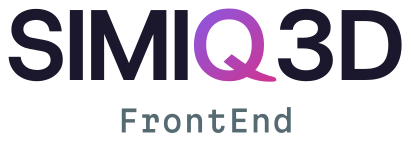

<p align="center">
  <picture>
    <source media="(prefers-color-scheme: dark)" srcset="../../design/brand/modules/simiq3d-frontend-dark.svg">
    
  </picture>
</p>


La app de SIMIQ3D en Angular y Three.js: el visor 3D de la mesa de Mayo y el
chat, servida en `/simiq3d/` desde el mismo origen que el shell de DataIQ. En
producción: <https://dataiq-frontend.vercel.app/simiq3d/>.

## Stack

- Angular 22 (componentes standalone, signals, sin `zone.js`), TypeScript 6 y SCSS.
- Three.js para el visor, con los modelos GLB comprimidos.
- La barra compartida del shell (`shared/shell/`) y los tokens de `shared/design/`.
- Pruebas con Vitest.

## Correrlo

Hace falta Node.js y el backend de DataIQ corriendo (ver
[`dataiq/backend/README.md`](../../dataiq/backend/README.md#correrlo)). Todo se corre desde
`simiq3d/frontend`:

```sh
npm install
npm start          # http://localhost:4300/simiq3d/
npm run models     # comprime los modelos 3D (corre solo antes de start y build)
npm run api:types  # tipos de las APIs, tras cambiar una ruta o un esquema de un backend
```

`npm run api:types` necesita `uv` (el de los backends), pero no que los
backends estén corriendo. Los tipos generados se versionan y se suben en el
mismo PR que cambia el backend.

`proxy.conf.json` manda `/api/dataiq` a `http://127.0.0.1:8000` y
`/api/simiq3d` a `http://127.0.0.1:8001`.

Para el chat hace falta también el backend de SIMIQ3D en el puerto 8001 (ver
[`../backend/README.md`](../backend/README.md)).

Para entrar con una cuenta: la cookie de sesión no distingue puertos, así que
sirve la que deja el ingreso del shell en `localhost:4200`. En desarrollo, el
shell no vuelve solo a `localhost:4300` después de ingresar (solo vuelve a
rutas de su mismo origen): hay que volver a mano. Sin el shell
corriendo, se puede pedir desde la consola del navegador, en
`localhost:4300/simiq3d/`:

```js
fetch('/api/dataiq/auth/login', {
  method: 'POST',
  headers: { 'Content-Type': 'application/json', 'X-IQ-Client': 'web' },
  body: JSON.stringify({ email: '<correo>', password: '<contraseña>' }),
});
```

## Pruebas

```sh
npm test           # Vitest
npm run build      # producción, con los presupuestos de angular.json
```

## Despliegue

El proyecto de Vercel `simiq3d-frontend` (cuenta de Mauricio, plan Hobby)
sirve la app como sitio estático. El workflow
[`simiq3d-frontend.yml`](../../.github/workflows/simiq3d-frontend.yml) corre
el build y las pruebas en cada PR y, en cada push a `main` que toque el
frontend o lo que su build lee de fuera, construye en GitHub Actions y publica
con el CLI de Vercel. Vercel no la construye, porque el build lee
`../../shared/design/`, `../../shared/shell/` (la barra) y `../models/glb/`,
que están fuera de esta carpeta.

- **La ruta completa.** El proyecto del shell trae la app con un rewrite
  `/simiq3d/:path*` hacia `https://simiq3d-frontend.vercel.app/simiq3d/:path*`
  (Resuelto 1 de la [checklist](../docs/checklist-frontend.md#resuelto)). Por
  eso la app se publica dentro de `simiq3d/`, y `vercel.json` manda a
  `simiq3d/index.html` toda ruta que no sea un archivo, como
  `/simiq3d/tecnicas/:id`.
- **CSP** (`vercel.json`): todo sale de este mismo origen, salvo las fuentes
  de `fonts.gstatic.com`, porque el build incrusta el CSS de Google Fonts. Las
  excepciones:
  - `'wasm-unsafe-eval'`: el decodificador meshopt de los modelos es
    WebAssembly;
  - `style-src 'unsafe-inline'`: Angular pone los estilos de cada componente
    en un `<style>`, y un sitio estático no puede firmarlos con un nonce;
  - `img-src data:`: la textura de tela de los tokens.

  Los scripts van sin `'unsafe-inline'`. Por eso el build de producción no
  incrusta el CSS crítico (`inlineCritical: false` en `angular.json`): esa
  optimización agrega un script en línea. Se comprobó el 2026-11-02 con la app
  completa (escena, fuentes y chat) en Brave: el navegador no bloqueó nada.
- **Caché.** El código y los estilos llevan un hash en el nombre, así que se
  guardan un año (`immutable`). Los modelos no lo llevan: se guardan un día y
  se siguen sirviendo una semana más mientras se revalidan
  (`stale-while-revalidate`), para que un modelo corregido llegue al día
  siguiente. `index.html` va sin caché, como lo deja Vercel.
- **Las APIs no pasan por este proyecto.** El navegador las pide al dominio
  del shell (`/api/dataiq/*`, `/api/simiq3d/*`), que tiene sus propios
  rewrites.

## Estructura

```
frontend/
├── public/             los modelos comprimidos y los íconos
├── scripts/            compresión de modelos y tipos de las APIs
└── src/
├── styles/                 theme.scss: el tema de SIMIQ3D sobre shared/design/
└── app/
    ├── core/
    │   ├── http/           base /api/dataiq y /api/simiq3d, interceptores: X-IQ-Client y errores
    │   └── session/        SessionService (cuenta de /auth/me), sessionGuard → ingreso del shell
    ├── domain/             reglas puras, sin Angular ni Three.js: las acciones del chat y
    │                       la geometría de la mesa (celda → posición en metros)
    ├── data/
    │   ├── dataiq.repository.ts    técnicas, mesa de una técnica, instrumentos
    │   └── simiq3d.repository.ts   chat y mapeo modelo 3D → instrumento
    ├── viewer/             ★ el visor en Three.js; ver abajo
    ├── chat/               mensajes, sugerencias y campo de pregunta
    ├── explore/            la pantalla: chat + visor (rutas / y /tecnicas/:id), con la
    │                       cabeza, la leyenda, la ficha, los controles de vista y la hoja
    │                       inferior del celular
    ├── shell/              la barra del shell
    └── shared/             media queries e iniciales del avatar, como en DataIQ
```

## Más documentación

- Qué es SIMIQ3D: [`../README.md`](../README.md).
- Decisiones, arquitectura, el visor, el chat y cómo se arma la mesa:
  [`../docs/frontend.md`](../docs/frontend.md).
- Cómo se habla con DataIQ (sesión, proxy, encabezados):
  [`dataiq/backend/README.md`, «Cómo lo usa el frontend»](../../dataiq/backend/README.md#cómo-lo-usa-el-frontend).
- Sistema de diseño: [`design/README.md`](../../design/README.md).
- Avance por fases: [`../docs/checklist-frontend.md`](../docs/checklist-frontend.md).
