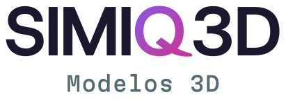

  <picture>
    <source media="(prefers-color-scheme: dark)" srcset="../../design/brand/modules/simiq3d-models-dark.svg">
    
  </picture>

Los 16 instrumentos de las cinco mesas de Cirugía General se reconstruyeron
sobre las fotos de IQ del 2026-11-18. Cada fila de
`modelos.csv` registra la foto o referencia, las medidas y lo que se infirió.

| Archivo | Contenido |
|---|---|
| `glb/*.glb` | Un modelo por instrumento. El frontend los comprime con `npm run models`. |
| `blender/*.blend` | Un archivo de Blender por instrumento. |
| `modelos.csv` | Identificación, dimensiones, fuentes y notas. |

El backend carga el mapeo con
`uv run python -m app.adapters.inbound.cli.load_models`. Lee los nombres o alias
de `modelos.csv`, busca los identificadores en DataIQ del mismo entorno y
reemplaza la tabla `model_mappings` completa en una transacción.

## Convenciones

- Escala real en metros, origen centrado en planta y a la altura del punto
  más bajo. El eje largo va en X con la punta hacia +X. El exportador cambia
  Z arriba en Blender por Y arriba en glTF.
- Menos de 2000 triángulos por modelo. Pinzas y tijeras ligeramente abiertas
  con sus detalles de prensión. Cada fila documenta la forma específica.
- Se hornea oclusión ambiental por vértice. El visor sustituye el material
  original por acero satinado y utiliza el atributo de color del GLB.
- Los mangos N.° 3 y N.° 4 se publican sin hojas. El nodo `blade_mount` marca
  el encastre. Si una pieza carece de GLB, se omite su geometría en el visor.

## Cómo se hicieron

Los 16 instrumentos de las cinco mesas se modelaron sobre las fotos que el
equipo tomó con el programa de IQ en el laboratorio el 2026-11-18. Son modelos propios, hechos en Blender: Blender es
gratis para cualquier uso y lo que se crea con él es de quien lo hace, así que
los modelos pueden ir en el repo y servirse en la web.

Cómo se hacen, un instrumento a la vez:

1. La foto se endereza con los cuatro marcadores ArUco y se pone a escala con
   su cuadrado negro de 6 cm.
2. Se traza el contorno del instrumento sobre la foto y se extruye con su ancho
   real. El espesor, que una foto desde arriba no muestra, se infiere.
3. Lo que la foto no deja ver (dientes, estrías, puntas) se toma de imágenes de
   referencia del instrumental.
4. Mauricio revisa cada modelo contra la foto y las referencias y lo aprueba
   antes de pasar al siguiente.

Se modeló en Blender controlado por MCP for Blender, con Claude Code y Codex, y
con scripts propios para enderezar la foto, trazar el contorno, comparar la
silueta del modelo con la de la foto y hornear la oclusión ambiental. Todo
queda en el repo: el `.blend` y el GLB de cada instrumento, y en
[`models/modelos.csv`](modelos.csv) sus medidas y su fuente (la foto,
una referencia o inferido).

**El primer juego de modelos** (23 instrumentos modelados a mano en Blender por
Guebriel con las medidas del catálogo de instrumental del CICR, integrados el
2026-10-30) se reemplazó porque, en la presentación del 2026-11-05, la tutora
de las estudiantes de IQ señaló que el instrumental de los modelos no era del
todo correcto.

Por qué no otras fuentes (revisadas el 2026-10-15):

| Fuente | Por qué no |
|---|---|
| Tiendas de pago (Unity Asset Store, TurboSquid, CGTrader) | Sus licencias prohíben redistribuir los modelos o dejar que se extraigan del producto; un visor web le entrega el archivo al navegador y el repo es público. Además, sus paquetes son genéricos: no traen Rochester, Babcock, Farabeuf ni Senn Miller, ni distinguen la pinza de disección con o sin garra |
| Modelos gratis de Sketchfab (CC BY) | La licencia sirve, pero lo que hay es genérico (bisturís, «forceps», un portaagujas), cada uno en un estilo y algunos de más de un millón de caras |
| Generadores de imagen a 3D (Meshy, Tripo) | Fallan en objetos delgados y metálicos con puntas finas, y la punta es justo lo que distingue un instrumento de otro: lo que inventen no sale de una fuente |

Las convenciones de cada modelo (escala, origen, orientación, nombres), qué
medidas son reales y cuáles inferidas, y cómo se mapea cada modelo a su
instrumento: [`models/README.md`](README.md).

## Más documentación

- Qué es SIMIQ3D: [`../README.md`](../README.md).
- Cómo se arma la mesa en el visor: [`../docs/frontend.md`](../docs/frontend.md#cómo-se-arma-la-mesa-en-3d).
