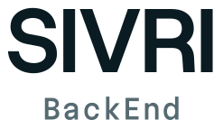

<p align="center">
  <picture>
    <source media="(prefers-color-scheme: dark)" srcset="../../diseno/marca/modulos/sivri-backend-oscuro.svg">
    
  </picture>
</p>

Reconoce el instrumental en cada cuadro de la cámara, ubica la mesa con los cuatro
marcadores ArUco y valida cada instrumento contra la mesa de Mayo de la técnica,
según el arreglo de DataIQ. Qué valida y por qué: [`../README.md`](../README.md).
Dataset y protocolo de fotos: [`../docs/dataset.md`](../docs/dataset.md). Licencia
AGPL-3.0 (ver [`../LICENSE`](../LICENSE)).

## Cómo está armado

Capas, como el backend de SIMIQ3D. Todo se corre desde `sivri/backend`.

| Dónde | Qué tiene |
|---|---|
| `app/domain/` | La lógica, sin framework ni modelo: la mesa a partir de los marcadores (`board.py`), lo que cada técnica espera (`expected.py`), el emparejamiento, los estados y el reconocimiento de la técnica (`validation.py`) y cómo se le dice al estudiante dónde va cada instrumento (`location.py`: zona, vecinos y número del diagrama) |
| `app/application/` | `FrameAnalyzer`: reduce el cuadro, busca marcadores e instrumentos y valida |
| `app/ports/` | Lo que el dominio necesita de afuera: detector, marcadores, catálogo, mapeo de clases, tokens |
| `app/adapters/inbound/` | La API (FastAPI) y el comando que carga el mapeo de clases |
| `app/adapters/outbound/` | OpenCV (marcadores), YOLO26 y el detector de pruebas, el catálogo de DataIQ, la validación de tokens (JWKS) y la base (SQLAlchemy) |
| `classes.csv` | Las 16 clases del modelo: el instrumento y su número al entrenar |
| `migrations/` | Alembic: una tabla, `class_mappings` |

## Qué expone

| Ruta | Para qué |
|---|---|
| `GET /health` | Que está en pie y dónde está el código fuente (la AGPL obliga a ofrecerlo) |
| `GET /techniques` | Las técnicas cuya mesa valida, con cuántos instrumentos espera de cada una |
| `POST /validate` | Un cuadro (JPEG o PNG, campo `image`) y, opcional, `technique_id`: el resultado |
| `WS /ws/validate` | El video continuo: el mismo resultado, cuadro por cuadro |

Todas, salvo `/health`, piden `Authorization: Bearer <token corto de DataIQ>`. La
documentación interactiva queda en `/docs`.

**El resultado de un cuadro** (`FrameOut`): `markers` (los que encontró),
`board_found` (están los cuatro), `detections` (cada instrumento, con su clase,
su id de DataIQ y su caja como fracción del cuadro), `recognized`, `techniques` (la
técnica que más se parece o, si quedan muy cerca, las dos que más; cada una con su
porcentaje, sus objetos y sus sobrantes) y `ranking` (las cinco). Cada objeto trae
su estado: `in_place`, `move` (con cuántas celdas hacia dónde), `doubtful`,
`missing` o `extra`. Sin los cuatro marcadores se nombra lo que se ve, pero no se
valida nada (`board_found: false`). Las imágenes se procesan y no se guardan.

### Video continuo

El celular manda 2 o 3 cuadros por segundo por un WebSocket (`/ws/validate`, con
`technique_id` opcional en la dirección):

1. Primer mensaje, de texto: `{"token": "<token corto>"}`. No va en la dirección
   porque un navegador no puede poner encabezados en un WebSocket y quedaría en los
   registros.
2. Después, cada cuadro como mensaje binario; la respuesta es
   `{"type": "result", "frame_number": N, "frame": {…}}`. `frame_number` es el orden
   del cuadro en la conexión (el primero que llega es el 1): la página los cuenta al
   enviarlos y así sabe a qué imagen corresponde cada resultado.
3. El token dura 5 minutos: la página manda otro `{"token": "…"}` antes de que
   venza. Si vence sin renovarlo, el servidor avisa (`token_expired`) y cierra con
   el código 4401.

Si llegan cuadros más rápido de lo que se procesan, solo se procesa el último: la
respuesta tiene que ser de lo que la cámara ve ahora, y los cuadros descartados no
tienen respuesta (su número se salta). Los errores de un cuadro (`invalid_image`,
`too_large`, `catalog_unavailable`) se avisan, con su `frame_number`, y la conexión
sigue.
Códigos de cierre: 4400 (el primer mensaje no lleva el token), 4401 (token inválido,
vencido o rechazado por DataIQ) y 4404 (técnica que no valida).

## Para quien hace el frontend

Lo que la página necesita de este backend, en el orden en que lo usa. El contrato
exacto de `POST /validate` está en `/docs`; los mensajes del WebSocket, en la
sección anterior (no salen en OpenAPI: sus tipos se escriben a mano).

**1. Token.** La página llama a DataIQ por su mismo origen (`/api/dataiq/auth/module-token`,
con la cookie y `X-IQ-Client: web`) y recibe `{access_token, expires_in}`. Lo renueva
poco antes de que venza y lo manda a SIVRI: en `Authorization: Bearer` (`/techniques`,
`/validate`) o en el primer mensaje del WebSocket y en cada renovación. Si DataIQ
responde 401, la sesión terminó: hay que ingresar de nuevo.

**2. Qué mandar.** El cuadro completo del video (sin recortar), desde un `canvas` en
JPEG, 2 o 3 por segundo y uno por vez: no mandar otro hasta recibir el resultado del
anterior o un error. El servidor reduce el lado mayor a `MAX_IMAGE_SIDE` (1280); mandar
menos baja el consumo de datos. Qué tamaño y calidad conviene está sin medir: se
decide con el celular real.

**3. Cómo dibujar.** Todo viene en fracciones del cuadro que se mandó (0 a 1), así que
se multiplican por el tamaño del dibujo. Si el `<video>` se muestra recortado
(`object-fit: cover`), la conversión tiene que contar el recorte. El resultado llega con
la demora de la red y el procesamiento: con `frame_number` se sabe de qué cuadro es, y
conviene dibujarlo sobre ese cuadro y no sobre el video de ahora.

**4. Qué trae el resultado** (`FrameOut`):

| Campo | Cómo leerlo |
|---|---|
| `board_found` | `false` si falta algún marcador de los cuatro (`markers` dice cuáles se ven, por su `id` 0 a 3). Entonces solo hay `detections`; `techniques` y `ranking` vienen vacíos |
| `detections[].label` | Nombre de la clase del modelo, listo para mostrar; `instrument_id` es `null` si la clase no está mapeada |
| `techniques` | La técnica que más se parece o, si quedan muy cerca, las dos. Cada una trae `objects` (lo esperado) y `extras` (lo que sobra) |
| `percent` | De 0 a 1 (no de 0 a 100). `in_place` cuenta también los dudosos: es el numerador del porcentaje |
| `objects[].status` | `in_place`, `move`, `doubtful` (no se le muestra nada al estudiante), `missing` (sin `box`) o `extra` |
| `objects[].message` | Lo que se le dice al estudiante, ya escrito: la zona de la mesa, lo que tiene al lado y su número del diagrama («Pinza Kelly (n.º 2): va en el centro, a la derecha, junto a Pinza Rochester (n.º 3).»). `null` si está en su lugar o dudoso. Se muestra tal cual |
| `objects[].move` | Solo con `move`, para dibujar una flecha: `rows` hacia abajo y `columns` hacia la derecha; negativos, hacia arriba y hacia la izquierda. No se le dice al estudiante en filas ni celdas: para eso es `message` |
| `objects[].legend_number` | El número del instrumento en el diagrama de IQ |

Un objeto que hay que mover, recortado de una respuesta real (`frame` de un resultado):

```json
{
  "board_found": true,
  "recognized": true,
  "techniques": [{
    "name": "Prueba", "percent": 0.667, "in_place": 2, "expected": 3,
    "objects": [{
      "status": "move", "label": "Pinza Kelly", "legend_number": 2,
      "expected_cells": [{"row": 2, "column": 3}],
      "found_cell": {"row": 2, "column": 2},
      "box": {"x1": 0.375, "y1": 0.391, "x2": 0.435, "y2": 0.438},
      "move": {"rows": 0, "columns": 1},
      "message": "Pinza Kelly (n.º 2): va en el centro."
    }],
    "extras": []
  }]
}
```

**5. Cuándo mostrar la técnica.** El backend valida todos los cuadros, y el porcentaje y
la técnica cambian de uno a otro. Propuesta de punto de partida, a ajustar con el
celular (no está decidida): mientras arma, nombrar lo que ve (`detections`); mostrar la
técnica cuando `board_found` sea `true` y la misma técnica salga primera en 5 resultados
seguidos (unos 2 segundos); dejar de mostrarla si `board_found` es `false` durante unos
segundos.

**6. Probar sin el modelo entrenado.** Con el detector de pruebas, que siempre
devuelve las mismas cajas, se ve cada estado sin cámara ni YOLO. En `examples/` hay un
cuadro con los cuatro marcadores (`frame.jpg`, 840 × 640) y las cajas de seis
instrumentos en píxeles de ese cuadro (`detections.json`). Con `.env` en
`DETECTOR=fake` y `FAKE_DETECTIONS=examples/detections.json`, y la API levantada
(ver «Correrlo»):

```sh
curl -H "Authorization: Bearer $TOKEN" -F image=@examples/frame.jpg \
  http://127.0.0.1:8002/validate
```

Las cajas están fijas en píxeles: con otro tamaño de cuadro, o con la cámara, la
estructura del resultado es la misma pero las cajas no coinciden con la imagen. Con
las pruebas (`uv run pytest`) también se puede ver cada mensaje: `tests/api/`.

**7. Ojo.**
- La cámara del navegador solo abre con HTTPS (o `localhost`): probar desde un celular
  contra un servidor local en http no funciona.
- Vercel no pasa WebSockets por sus reescrituras: la página se conecta directo a
  `wss://` del Servidor PC1 (ver «Vista previa en PC1»). La dirección de SIVRI va
  en la configuración del frontend, no en una ruta del mismo origen.
- Desde el navegador, `CORS_ORIGINS` tiene que incluir el origen de la página, también
  en desarrollo (por ejemplo `["http://localhost:4200"]`). El WebSocket no pasa por
  CORS; lo protege el token.
- Los errores HTTP: 401 (DataIQ no aceptó el token), 404 (técnica que no valida), 413
  (cuadro demasiado grande), 422 (no es una imagen) y 503 (DataIQ no responde).

## Correrlo

Hace falta [uv](https://docs.astral.sh/uv/), Podman y el backend de DataIQ corriendo
(ver [`../../dataiq/README.md`](../../dataiq/README.md)).

1. PostgreSQL 18 en un contenedor propio (puerto 5434), aparte de los de DataIQ y
   SIMIQ3D:

   ```sh
   podman run -d --name sivri-db -p 5434:5432 \
     -e POSTGRES_USER=sivri -e POSTGRES_PASSWORD=<contraseña> -e POSTGRES_DB=sivri \
     -v sivri-db-datos:/var/lib/postgresql docker.io/library/postgres:18
   ```

2. Copiar `.env.example` a `.env` y poner la URL de esa base.
3. Crear la tabla y cargar el mapeo de clases (necesita una cuenta de DataIQ; en
   local sirven las de desarrollo):

   ```sh
   uv run alembic upgrade head
   DATAIQ_TOKEN=<token de POST /auth/token de DataIQ> \
     uv run python -m app.adapters.inbound.cli.load_classes
   ```

   Cada fila de `classes.csv` debe resolver a un instrumento de DataIQ. La columna
   opcional `instrumento` indica su nombre o alias cuando difiere de `clase`.
   Si falta un instrumento, la carga se detiene y lo indica. Hay que volver a
   correr el comando en cada entorno,
   porque los ids de DataIQ cambian de una instalación a otra.
4. Levantar la API:

   ```sh
   uv run fastapi dev app/main.py --port 8002
   ```

5. Con el modelo entrenado: `uv sync --extra yolo` (PyTorch solo para CPU), poner
   los pesos en `models/sivri.pt` y en el `.env` `DETECTOR=yolo`. Cada clase del
   modelo tiene que llamarse como en `classes.csv`. Sin eso corre el detector de
   pruebas (`DETECTOR=fake`), que no ve nada o lee las detecciones de un archivo
   JSON (`FAKE_DETECTIONS`) para probar la API y la página.

Pruebas y estilo (las pruebas crean y migran su propia base, `sivri_test`, en el
mismo servidor):

```sh
uv run pytest
uv run ruff check . && uv run ruff format --check .
```

## Decisiones de la implementación

Lo que el README de SIVRI no fija y quedó así (puntos de partida que se ajustan con
las fotos de la sesión de validación; decididos al implementar, el 2026-11-18, a
confirmar por Mauricio):

- **La mesa** va entre los **centros** de los cuatro marcadores (0 arriba a la
  izquierda, 1 arriba a la derecha, 2 abajo a la derecha, 3 abajo a la izquierda,
  como en `marcadores-aruco.pdf`: diccionario 4x4 de 50). La cuadrícula de cada
  técnica se reparte sobre el área ampliada un 10 % por lado (`BOARD_PADDING=0.10`),
  según la decisión de Mauricio del 2026-11-19 documentada en
  [DataIQ](../../dataiq/README.md#mesas-de-mayo-de-cirugía-general). Si falta un
  marcador no se valida.
- **Emparejar.** Se aplica la regla de copias y posiciones descrita en
  [Cómo se valida la mesa](../README.md#cómo-se-valida-la-mesa).
- **Margen técnico:** 10 % del lado de la celda (`CELL_MARGIN`). Un objeto de varias
  celdas no tiene margen en el borde entre ellas.
- **Porcentaje:** instrumentos «en su lugar» o «dudosos» sobre los esperados: un
  dudoso no es un error para el estudiante (el README dice que no se le muestra
  nada), así que cuenta como bien.
- **Muy cerca:** se muestran las dos técnicas cuando su porcentaje difiere en 5
  puntos o menos (`CLOSE_GAP`); el README no da la cifra.
- **Qué se espera:** un instrumento por componente de cada objeto, solo si es clase
  del modelo. La pinza de disección con garra y la sin garra se evalúan
  como dos instrumentos incluso cuando aparecen apilados.
- **Cuándo está «armada» la mesa:** el backend siempre valida y devuelve el
  porcentaje; la página decide qué mostrar mientras el estudiante arma (nombrar lo
  que ve) y cuándo mostrar la técnica.

## Ensayo local del WebSocket

El 2026-11-19 se reprodujeron tres fotos de Colecistectomía de Ronda 3 en
una conexión local, con YOLO26n en CPU y el catálogo de DataIQ cargado en
memoria. Se envió un cuadro por vez, hasta tres por segundo. Excluido el
primer cuadro, las 12 respuestas tardaron una mediana de 79,7 ms desde el
envío hasta la recepción, con un rango de 64,1 a 92,1 ms. Queda por medir
el tiempo de punta a punta con captura de celular, red y autenticación
real.

En las tres fotos se detectaron los cuatro ArUco y Colecistectomía quedó
primera. La foto «Bien Armada» recibió una indicación para mover la Allis
y la de «Error B» no recibió indicaciones. El ensayo verifica la conexión
y deja esos casos para revisar con IQ en la evaluación espacial.

## Vista previa en PC1

La API de vista previa del 2026-11-19 está en
`https://fedora.tail5cf085.ts.net:8443` y el video en
`wss://fedora.tail5cf085.ts.net:8443/ws/validate`. Funnel reenvía el puerto
8443 a SIVRI en `127.0.0.1:8002`. DataIQ escucha en `127.0.0.1:8000`.

PC1 usa unidades permanentes de usuario de systemd, como el filtro de
SIMIQ3D. Se instalan en `~/.config/systemd/user/` desde
[`../servidor-pc1/`](../servidor-pc1/). Ambas APIs están habilitadas en
`default.target` y el usuario tiene habilitado el arranque sin sesión
(`Linger=yes`). Cada API inicia su contenedor PostgreSQL local y espera
a que responda `pg_isready`. Se usan las bases y pesos ya instalados
según «Correrlo».

Para instalar las unidades en un PC1 preparado, desde la raíz del repo:

```sh
install -d ~/.config/systemd/user
install -m 644 sivri/servidor-pc1/*.service ~/.config/systemd/user/
systemctl --user daemon-reload
systemctl --user enable --now iq-dataiq-pc1.service iq-sivri-pc1.service
```

Para consultar el estado, usar `systemctl --user status iq-sivri-pc1` y
`journalctl --user -u iq-sivri-pc1`. El servicio de sistema `tailscaled`
mantiene la configuración de Funnel fuera de estas unidades.

Se comprobó por HTTPS y WSS el inicio de sesión en DataIQ local, la emisión
del JWT de cinco minutos, el rechazo de un token inválido y la renovación en
una conexión abierta. La vista previa usa el catálogo y las llaves del DataIQ
local. En una sesión desde PC1 por la IP pública de Funnel, la conexión
procesó 25 cuadros en 316,4 s. Se renovó el JWT en la misma conexión y
se recibieron cuadros después del vencimiento original. Una conexión
nueva rechazó el JWT vencido con código 4401. Con el JPEG de 478,9 kB,
la mediana tras el primer cuadro fue de 1,10 s.

En seis fotos de Ronda 3, SIVRI detectó los cuatro marcadores y puso primera
la técnica indicada por el archivo. En Mastectomía Error A indicó mover
Kelly y Farabeuf, y en Tiroidectomía Error A, la tijera de Mayo. En
Eventrorrafia Error A omitió ambas indicaciones esperadas y en Error B
reportó ausencias en vez de indicar el intercambio. Las anotaciones de los
errores están para confirmar con IQ.

### Tamaño del cuadro por Funnel

Ensayo desde PC1 contra la IP pública de Funnel, con JPEG de Mastectomía
Error A y un JWT real. Se enviaron seis cuadros de cada tamaño, uno por
vez, con calidad JPEG 75.

| Lado mayor | Tamaño por cuadro | Mediana envío–respuesta |
|---:|---:|---:|
| 960 px | 90,4 kB | 294 ms |
| 640 px | 45,4 kB | 248 ms |

En ambos tamaños se detectaron los cuatro marcadores y se indicó mover
Kelly y Farabeuf. El ensayo usa una sola foto. Falta medir desde el
celular y con cuadros en vivo.

### Diagnóstico de la retroalimentación

Se revisaron las 35 fotos de Ronda 2 y las 35 de Ronda 3 con el despliegue
de PC1. La comparación fija la técnica indicada por el archivo y pasa al
mismo validador los centros de YOLO y los de las cajas anotadas. Las
anotaciones están para confirmar con IQ. Se detectaron cuatro ArUco en 31
fotos de Ronda 2 y en 33 de Ronda 3. Las demás se excluyeron de la
comparación espacial.

| Foto de Ronda 3 | Con YOLO26n | Con las cajas anotadas |
|---|---|---|
| Colecistectomía bien armada, IMG_1853 | Pide mover la Allis. El centro cae en la fila siguiente | El centro cae dentro de su celda, cerca del borde |
| Eventrorrafia Error A, IMG_1880 | Da por bien ubicadas Metzenbaum y Kelly Adson, con cada clase en la posición de la otra según las anotaciones | Pide mover ambas |
| Eventrorrafia Error B, IMG_1882 | Reporta que faltan Kelly y Allis | Pide mover ambas |
| Mastectomía Error A, IMG_1925 | Pide mover Kelly y Farabeuf | Pide mover ambas |

En Ronda 2, ampliar `CELL_MARGIN` de 0,10 a 0,20 mantuvo en cero las
indicaciones de mover en las 13 fotos «Bien Armada» con cuatro marcadores.
En las 18 fotos de error con cuatro marcadores, bajó de 33 a 30 las
indicaciones de mover. Las ausencias y sobrantes siguieron iguales. Se
conservó 0,10 en PC1 y no se ajustó el modelo ni la cuadrícula con Ronda 3.
Estas cifras cuentan indicaciones durante el diagnóstico.

## Lo que falta

- Configurar el DataIQ y el origen del shell que se usarán para el piloto.
- Medir con un celular y revisar los casos de retroalimentación con IQ.
- Probar el frontend de SIVRI ([`../frontend/README.md`](../frontend/README.md)) con un celular y contra este backend.

## Diagnóstico local con 16 clases del 2026-11-22

Se procesaron los JPG normalizados de las rondas 2 y 3 con `sivri-r2`,
confianza 0,35, entrada YOLO de 640 px y cuadro reducido a 1280 px en el
lado mayor. El margen de celda y la ampliación del marco fueron de 0,10.
Se cargaron en memoria las cinco mesas de la semilla local de DataIQ y se
cotejaron las 30 asignaciones aprobadas el 2026-11-21. Contienen 57 objetos
reconocibles. El ensayo usó el validador con la regla de duplicados.

| Ronda | Fotos con cuatro ArUco | Técnica correcta primera | Presente entre las mostradas | Bien armadas con algún aviso¹ |
|---|---:|---:|---:|---:|
| 2 | 31/35 | 26/31 | 27/31 | 13/13 |
| 3 | 33/35 | 24/33 | 26/33 | 10/13 |

¹ Para diagnosticar ubicación se tomaron los resultados de la técnica
indicada en el índice de fotos. En las 13 mesas bien armadas evaluables de
Ronda 3 aparecieron 20 avisos de ausencia y 9 de movimiento. Con las cajas
anotadas quedaron 10 de movimiento en cinco fotos. En Ronda 2 quedaron
28 avisos de movimiento con las cajas anotadas, 17 de ellos sobre disecciones.
La referencia de las fotos bien armadas contribuyó a definir las celdas. Los
errores intencionales de A/B carecen de confirmación de IQ. La concordancia
con las cajas permite localizar discrepancias del detector y de la geometría.
Sin un registro de los errores puestos en A y B, estas fotos no miden la
precisión ni la exhaustividad frente a errores confirmados.

## Celdas recalculadas con las tres rondas (2026-11-23)

Las celdas de las cinco mesas se recalcularon con la regla del
[README del módulo](../README.md#qué-es-una-mesa-correcta) («De dónde salen las
celdas»). Se proyectaron con los marcadores ArUco las cajas anotadas de las 42
fotos «Bien armada» de las tres rondas que tienen los cuatro marcadores (466
centros) y se contó, con el margen de 0,10, cuántos centros caen fuera de las
celdas de su instrumento y fuera del margen, es decir, cuántas indicaciones de
mover daría SIVRI con las cajas anotadas:

| Técnica | Celdas del 2026-11-21 | Celdas recalculadas |
|---|---:|---:|
| Colecistectomía | 15 | 6 |
| Eventrorrafia | 15 | 3 |
| Hemicolectomía derecha | 10 | 6 |
| Mastectomía | 6 | 3 |
| Tiroidectomía | 3 | 0 |
| **Total** | **49** | **18** |

Cambiaron las celdas de 19 de los 57 objetos, casi todos con una celda vecina
más. Las 18 indicaciones que quedan son de rondas en que el programa de IQ
invirtió el orden de dos piezas (por ejemplo, los dos mangos de bisturí), que
ninguna asignación fija de celdas cubre. Las fotos de la Ronda 3 ya habían
servido para las celdas del 2026-11-21, así que esta medición describe la
concordancia con las fotos de referencia y no es una prueba independiente.
