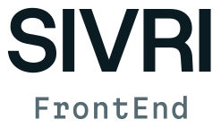

<p align="center">
  <picture>
    <source media="(prefers-color-scheme: dark)" srcset="../../design/brand/modules/sivri-frontend-dark.svg">
    
  </picture>
</p>

La app de SIVRI en Angular: en el celular abre la cámara, manda cuadros al
backend por un WebSocket y dice qué está en su lugar, qué mover y qué falta; en
el computador solo explica y lleva al celular. Se sirve en `/sivri/` desde el
mismo origen que el shell. En producción: <https://dataiq-frontend.vercel.app/sivri/>.
Licencia AGPL-3.0 ([`../LICENSE`](../LICENSE)); puede usar código MIT del
repositorio (`shared/shell/`, `shared/design/`).

## Stack

- Angular 22 (componentes standalone, signals, sin `zone.js`), TypeScript 6 y SCSS.
- La barra compartida del shell (`shared/shell/`) y los tokens de `shared/design/`.
- Tipos de las APIs generados del OpenAPI de DataIQ y de SIVRI; los mensajes del
  WebSocket, escritos a mano en `src/app/data/socket-messages.ts`.
- Pruebas con Vitest.

## Correrlo

Hace falta Node.js y el backend de DataIQ corriendo
([`dataiq/backend/README.md`](../../dataiq/backend/README.md#correrlo)). Todo se
corre desde `sivri/frontend`:

```sh
npm install
npm start          # http://localhost:4400/sivri/
npm run api:types  # tipos de DataIQ y de SIVRI, tras cambiar una ruta o un esquema
```

- `proxy.conf.json` manda `/api/dataiq` a `http://127.0.0.1:8000`. El backend de
  SIVRI se llama directo (`http://127.0.0.1:8002`, en `src/environments/`), y su
  `CORS_ORIGINS` tiene que incluir `http://localhost:4400`.
- La cámara solo abre con HTTPS o en `localhost`. En el computador se prueba todo
  el recorrido con el backend en `DETECTOR=fake` y la cámara falsa del navegador;
  en el celular, con el despliegue de vista previa.
- Para entrar con una cuenta sirve la cookie que deja el ingreso del shell en
  `localhost:4200`; en desarrollo, la vuelta a `localhost:4400` es a mano.
- En Windows, `src/shared-shell` es un enlace simbólico que hay que reemplazar
  por un *junction* para compilar.

## Pruebas

```sh
npm test       # Vitest
npm run build  # producción, con los presupuestos de angular.json
```

## Despliegue

El proyecto de Vercel `sivri-frontend` sirve la app como sitio estático, con su
propio token (`VERCEL_TOKEN_SIVRI`). El workflow
[`sivri-frontend.yml`](../../.github/workflows/sivri-frontend.yml) corre el build
y las pruebas en cada PR y, en cada push a `main`, construye en GitHub Actions y
publica con el CLI de Vercel.

- **La ruta completa:** el shell la trae con un rewrite `/sivri/:path*` hacia
  `https://sivri-frontend.vercel.app/sivri/:path*`, así que la app se publica
  dentro de `sivri/`.
- **Encabezados:** valen los de este proyecto: `Permissions-Policy: camera=(self)`
  y una CSP con la dirección `https://` y `wss://` del backend de SIVRI. Al
  cambiar esa dirección (`environments/`), se cambia también en `vercel.json`.
- **Caché:** el código lleva un hash en el nombre y se guarda un año;
  `index.html` va sin caché.
- **Licencia:** la interfaz lleva el enlace «Código fuente (AGPL-3.0)» al
  repositorio, el mismo de `GET /health`.

## Estructura

```
frontend/
├── public/                el código QR, las fotos de la entrada y el favicon
├── scripts/               tipos de las APIs
└── src/
    ├── environments/      direcciones del shell y del backend de SIVRI
    ├── shared-shell/      enlace a la barra compartida de shared/shell/
    ├── styles/            el tema de SIVRI sobre shared/design/
    └── app/
        ├── core/          http, sesión, token corto y layout
        ├── domain/        lectura del resultado, marcadores, geometría y recorrido
        ├── data/          DataIQ y el WebSocket de SIVRI
        ├── camera/        cámara, captura y ritmo de envío
        ├── check/         la página de la cámara y sus paneles
        ├── entry/         la entrada (celular y computador)
        ├── ui/            botón, enlace con flecha, grupo y pie
        └── shell/, shared/
```

## Más documentación

- Qué es SIVRI: [`../README.md`](../README.md).
- Decisiones, arquitectura, recorrido, rutas y errores:
  [`../docs/frontend.md`](../docs/frontend.md).
- Qué espera el backend: [`../backend/README.md`](../backend/README.md#cómo-lo-usa-el-frontend).
- Sistema de diseño: «SIVRI: celular y computador (mockups)» en
  [`design/README.md`](../../design/README.md); las pantallas, en el
  [Figma del proyecto](https://www.figma.com/design/jHEduZTQNBs4CCJEWB8u5v/).
- Avance: [`../docs/checklist-frontend.md`](../docs/checklist-frontend.md).
