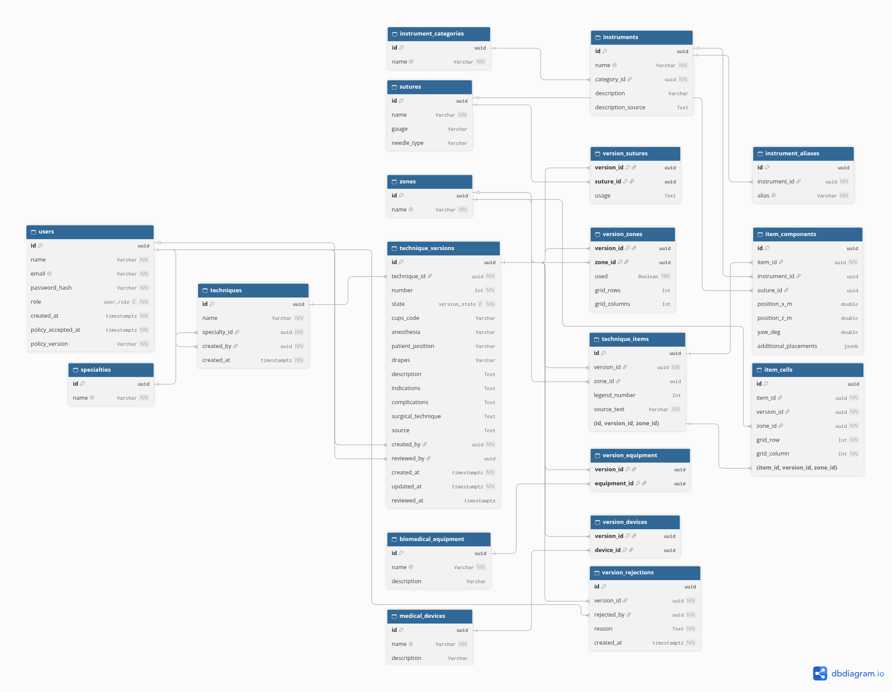
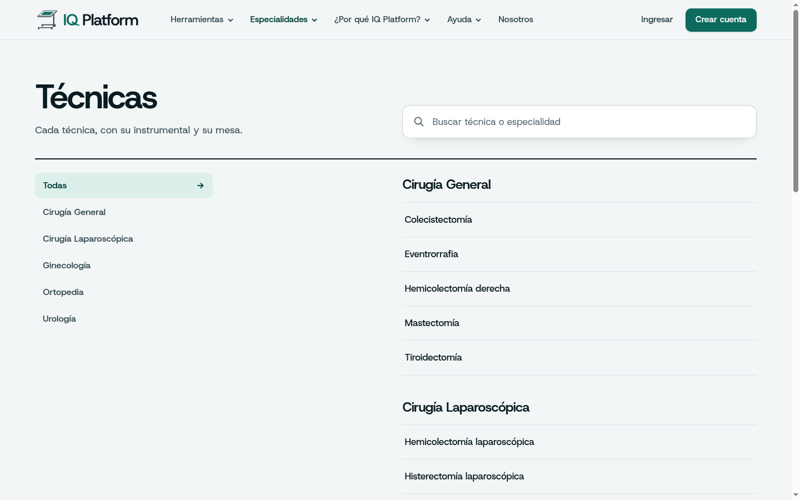
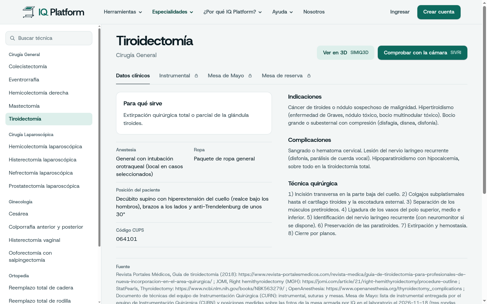
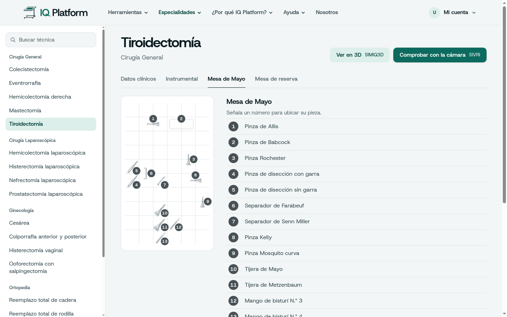

# Desarrollo del módulo DataIQ

<!--
Notas de trabajo (no forman parte del informe).

## Qué lleva

- Arquitectura.
- Modelo de datos (con la figura del modelo entidad-relación).
- Versionado de técnicas y modelo de roles (con la tabla de roles).
- Seguridad.
- Construcción del dataset.
- Interoperabilidad (cómo lo leen SIVRI y SIMIQ3D).
- Infraestructura de despliegue.
- Diseño de la interfaz.

## Fuentes en el repositorio

- [`dataiq/README.md`](../../../dataiq/README.md).
- Esquema: [`dataiq/docs/esquema.dbml`](../../../dataiq/docs/esquema.dbml) y su
  diagrama `dataiq/docs/diagramabd.png`.
- [`dataiq/docs/checklist-backend.md`](../../../dataiq/docs/checklist-backend.md)
  y [`dataiq/docs/checklist-frontend.md`](../../../dataiq/docs/checklist-frontend.md).
- [`docs/flujos.md`](../../../docs/flujos.md).
-->

El backend de DataIQ lo desarrolló Mauricio Lugo con asistencia de Claude
Code; el frontend de DataIQ y el shell de navegación, en Angular, los
desarrolló Juan Caraballo. En el segundo corte se construyó el backend; en el
tercero pasó a producción, se completó el frontend y se rehicieron las mesas de
Mayo de Cirugía General.

## Arquitectura

El módulo se construyó con arquitectura hexagonal, organizada en tres partes. El dominio contiene las reglas del negocio: los estados de las versiones de una técnica, los permisos de cada rol y la validación del arreglo de mesa. Los puertos definen los contratos que el dominio requiere del exterior, como el acceso a los datos y los servicios de seguridad. Los adaptadores implementan esos contratos: de entrada, una API REST construida con FastAPI y una herramienta de línea de comandos; de salida, el acceso a PostgreSQL mediante SQLAlchemy asíncrono, el cifrado de contraseñas y la firma de tokens. Esta separación permite que el núcleo no dependa de la base de datos ni del framework web.

## Modelo de datos

El modelo entidad-relación (figura del modelo entidad-relación) comprende
dieciocho tablas en PostgreSQL 18, creadas y versionadas mediante migraciones
de Alembic. Los identificadores son UUIDv7 generados por la propia base de
datos: no se repiten entre instalaciones y su orden sigue el de creación, pero
cada instalación genera los suyos al cargar el catálogo. Por eso SIVRI y
SIMIQ3D no guardan identificadores de DataIQ: mapean el instrumental por su
nombre o un alias y lo traducen al identificador de cada entorno con la API de
DataIQ. Las fechas se almacenan con zona horaria, y las restricciones de
integridad (unicidad, verificaciones y claves foráneas compuestas) se declaran
en la base de datos y no solo en el código de la aplicación.

El arreglo de mesa se representa como una cuadrícula discreta de filas y
columnas, porque los arreglos de la documentación fuente son diagramas
elaborados a mano y no medidos. Para las mesas de Mayo de las cinco técnicas de
Cirugía General, que se fotografiaron en el laboratorio, cada instrumento guarda
además su posición y su giro medidos (en metros y grados) y las celdas en que
cae; esas columnas se agregaron el 2026-11-21 con dos migraciones que solo
agregan columnas. Conforme al criterio acordado con el programa de
Instrumentación Quirúrgica, se registra la posición del instrumental y no su
cantidad. Los objetos compuestos, como una compresa con sutura y portaagujas,
se registran como un único objeto con varios componentes.

*Fig. 3. Modelo entidad-relación del módulo DataIQ en el tercer corte. Fuente: elaboración propia.*

## Versionado de técnicas y modelo de roles

Cada técnica conserva únicamente su identidad, compuesta por el nombre y la especialidad, y todo su contenido clínico pertenece a una versión. Una versión pasa por los estados de borrador, en revisión, publicada, reemplazada y archivada. La edición de una técnica publicada genera una versión nueva en borrador; al publicarla, la versión anterior pasa a reemplazada dentro de la misma transacción. Cada técnica admite como máximo una versión publicada y una en curso, y solo la versión publicada se expone a los estudiantes y a los módulos SIVRI y SIMIQ3D. Cuando un revisor rechaza una versión, debe indicar el motivo, que queda registrado junto con su autor y su fecha.

El acceso se organiza en roles acumulativos, descritos en la Tabla VIII. Un colaborador no puede publicar, de modo que ningún contenido llega a los estudiantes sin la aprobación de un revisor. Si dos revisores deciden sobre la misma versión al mismo tiempo, el sistema bloquea el registro durante la operación y rechaza la segunda decisión.

**TABLA VIII. Roles de acceso al módulo DataIQ**

| Rol | Permisos | Asignación |
|---|---|---|
| Visitante | Consulta del catálogo de técnicas y de los datos clínicos de cada una | Sin cuenta |
| Usuario | Lo anterior, más el instrumental y los arreglos de mesa; uso de SIVRI y SIMIQ3D | Autorregistro gratuito |
| Colaborador | Lo anterior, más la creación y edición de borradores y su envío a revisión | Asignado por un administrador |
| Revisor | Lo anterior, más la aprobación o el rechazo de versiones, la publicación directa de las propias, el archivado de técnicas y la edición del instrumental | Asignado por un administrador a docentes o instrumentadores titulados |
| Administrador | Lo anterior, más la asignación de roles | Equipo operativo del proyecto |

*Fuente: elaboración propia.*

## Seguridad

Las contraseñas se almacenan cifradas con Argon2id, el algoritmo recomendado por el RFC 9106 [53]. La autenticación emplea tokens JSON Web Token [54] firmados con el algoritmo EdDSA [55]: DataIQ firma con una clave privada que solo él posee y publica la clave pública correspondiente, de modo que SIVRI y SIMIQ3D validan la identidad del usuario sin compartir ningún secreto. Cada token tiene una vigencia de dos horas y, en el navegador, viaja en una cookie que el código de la página no puede leer (ver la plataforma común). Al registrarse, el usuario acepta la política de tratamiento de datos, y el sistema conserva la fecha y la versión aceptadas como prueba de la autorización exigida por el Decreto 1377 de 2013 [40].

## Construcción del dataset

Las dieciocho técnicas, distribuidas en cinco especialidades, se estructuraron a partir de la documentación entregada por el programa de Instrumentación Quirúrgica. Cada arreglo de mesa se transcribió a la cuadrícula, y la información se completó con fuentes citables que quedan registradas en cada técnica para su posterior validación. Cada procedimiento incluye su código de la Clasificación Única de Procedimientos en Salud (CUPS) vigente [35]. Cada mesa y cada objeto registra su origen: tomado de la documentación del programa, corregido con información que la misma documentación aclara, o propuesto con base en los principios publicados de armado de mesa cuando la fuente no incluye el arreglo o este no es consistente. Los datos corregidos y propuestos quedan sujetos a la validación del programa de Instrumentación Quirúrgica. La carga en la base de datos se realiza mediante un programa que valida el archivo completo y no registra ningún dato si encuentra un error. Las mesas de Mayo de las cinco técnicas de Cirugía General se rehicieron después con las listas y las fotos del programa; las de las otras trece técnicas siguen como se transcribieron de la documentación.

## Interoperabilidad

SIVRI y SIMIQ3D no acceden a la base de datos de DataIQ: consultan su API por HTTPS. La API ofrece una consulta que entrega el catálogo completo en una sola respuesta, para que esos módulos lo conserven durante la sesión del usuario. Todas las consultas informan al cliente durante cuánto tiempo puede reutilizar la respuesta y le permiten verificar si cambió sin descargarla de nuevo.

## Mesas de Mayo medidas en las fotos de IQ

Las mesas de Mayo de las cinco técnicas de Cirugía General se actualizaron con
las listas que entregó el programa de Instrumentación Quirúrgica y con las
fotos tomadas en la visita del 2026-11-18 (versiones publicadas el
2026-11-19 y el 2026-11-20). El 2026-11-21 se agregó al esquema la posición
medida y el giro de cada instrumento (`position_x_m`, `position_z_m`,
`yaw_deg` y `additional_placements` en `item_components`), con dos
migraciones que solo agregan columnas. Las posiciones se midieron en las fotos
«Bien armada», enderezadas con los cuatro marcadores ArUco y a escala con su
cuadrado de 6 cm; las lecturas dudosas quedan marcadas como «propuesto».
Desde el mismo día, cada instrumento de la mesa es su propio objeto de la
leyenda (las tijeras, los mangos y las dos pinzas de disección dejaron de
agruparse), por decisión de Mauricio Lugo. Las mesas se publican en
producción como versiones nuevas, sin borrar el historial.

## Cambios del tercer corte

En el tercer corte el backend de DataIQ pasó del prototipo del segundo corte a
un servicio en producción. Mauricio Lugo lo desarrolló con asistencia de Claude
Code; el frontend de DataIQ y el shell de navegación, en Angular, los desarrolló
Juan Caraballo, por fases.

- **Código en inglés** (decidido por el equipo el 2026-10-13): nombres de
  tablas, columnas, rutas y campos en inglés; mensajes, documentación e
  interfaz en español.
- **Contenedor e integración continua:** imagen de contenedor del backend y
  pruebas automáticas en cada PR.
- **Despliegue en Vercel** (2026-10-14), con la base en Neon.
- **Sesión con cookie y token corto para los módulos**, descritos en la
  plataforma común.
- **Aviso de privacidad y supresión de cuentas** (2026-10-29), conforme a la
  Ley 1581 de 2012 y al Decreto 1377 de 2013; la aceptación del aviso queda
  registrada en cada cuenta.
- **Límite de intentos** al ingresar y al registrarse (2026-11-02).
- **Descripción del instrumental de la mesa de Mayo, con su fuente**
  (2026-10-28), que SIMIQ3D muestra al tocar un instrumento.
- **Gestión de versiones para el frontend:** las versiones con su contenido,
  sus rechazos y el filtro por técnica, y la actividad de cada cuenta.

## Diseño de la interfaz

Se diseñaron los prototipos navegables de la capa de navegación y del módulo DataIQ. La capa de navegación comprende el inicio, el catálogo de técnicas y el ingreso o la creación de cuenta. DataIQ comprende la consulta de cada técnica y la gestión según el rol: borradores y editor por pasos, revisión de versiones, publicación directa, archivado, catálogo de instrumental y gestión de roles. Los prototipos incluyen un recorrido por cada rol y un sistema de diseño (colores, tipografía y componentes) que se reutilizará en SIVRI y SIMIQ3D.

## El frontend de DataIQ y el shell

Juan Caraballo diseñó la arquitectura del frontend (2026-10-14) y desarrolló en
Angular el frontend de DataIQ y el shell de navegación, por fases, cada una en
su PR:

**TABLA IX. Fases del frontend de DataIQ y del shell de navegación**

| Fase | Qué | Fecha |
|---|---|---|
| 0 | Base del proyecto en Angular, con su presupuesto de tamaño del código | 2026-10-28 |
| 1 | Núcleo: roles y estados de las versiones, un repositorio por recurso de la API y el cliente HTTP con el encabezado contra falsificación de peticiones y el manejo de errores | 2026-10-29 |
| 2 | Shell: las rutas, la barra superior y la página «No encontrada» | 2026-10-29 |
| 3 | Diagrama de la mesa, con su leyenda enlazada | 2026-10-30 |
| 4 | Páginas públicas: inicio, catálogo con buscador y detalle de la técnica por pestañas | 2026-11-01 |
| 5 | Cuenta: aviso de privacidad, ingresar y crear cuenta | 2026-11-02 |
| 6 | Gestión del colaborador: «Mis borradores» y el editor de técnicas | 2026-11-02 |
| 7 | Gestión del revisor: versiones por revisar y revisión lado a lado | 2026-11-03 |
| 8 | Gestión del administrador: usuarios y roles | 2026-11-04 |
| 9 | Despliegue en Vercel | Tercer corte |
| 10 | Página «Nosotros», a partir de su mockup en Figma | 2026-11-21 |

*Fuente: elaboración propia a partir de `dataiq/docs/checklist-frontend.md`.*

Entre sus decisiones de diseño, registradas en `DESIGN.md`: los avisos de la
interfaz, planos y sin colores de estado (2026-10-28); una mesa de Mayo de
ejemplo en la portada, porque un visitante sin cuenta no puede pedir las mesas
(2026-10-31); qué muestra la aplicación cuando la API no responde, sin mandar a
ingresar a quien quizá tiene sesión (2026-11-01); y lo que la revisión y la
gestión de usuarios dejan para después del MVP (2026-11-02 y 2026-11-03). La página
«Nosotros» lleva un carrusel de fotos del equipo y del laboratorio, los dos
programas y el equipo.

*Fig. 4. El catálogo de técnicas de DataIQ, por especialidad. Fuente: elaboración propia (2026-11-22).*

*Fig. 5. La ficha de una técnica en DataIQ: datos clínicos y fuente. Fuente: elaboración propia (2026-11-22).*

*Fig. 6. La mesa de Mayo de Tiroidectomía en DataIQ, con su diagrama numerado y su leyenda. Fuente: elaboración propia (2026-11-22).*

> **[Imagen]** Captura de la página «Nosotros».
>
> *Fig. 7. La página «Nosotros» de la plataforma. Fuente: elaboración propia.*

> **[Imagen]** Captura de la gestión del revisor (lista «Por revisar» o una revisión).
>
> *Fig. 8. La revisión de versiones en DataIQ. Fuente: elaboración propia.*
