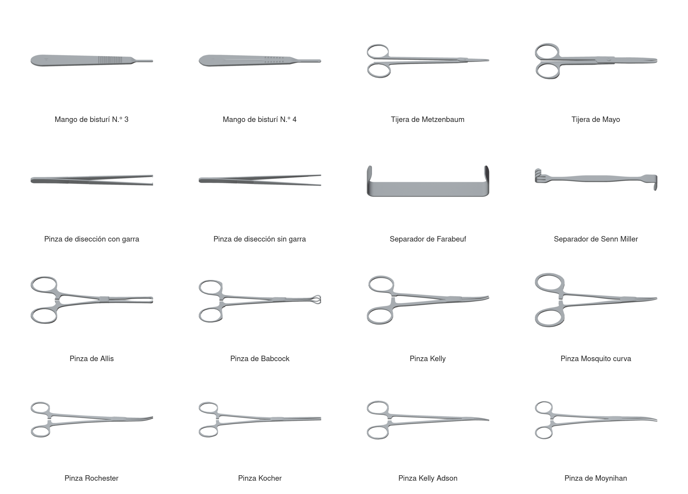
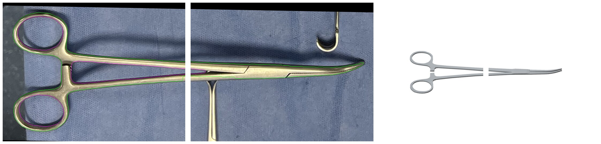
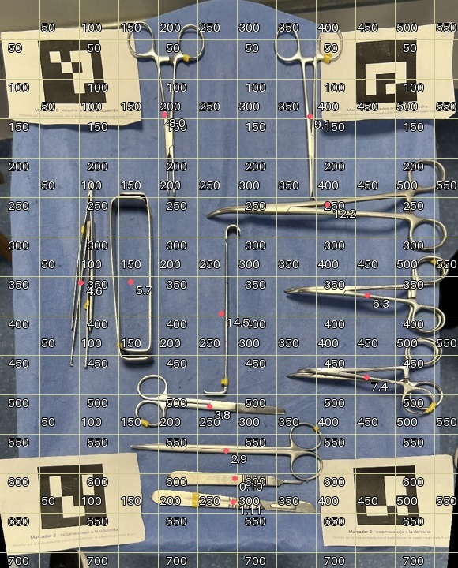
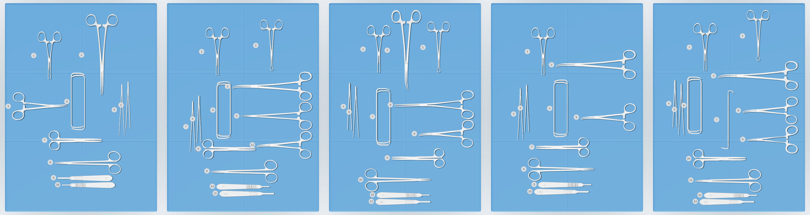
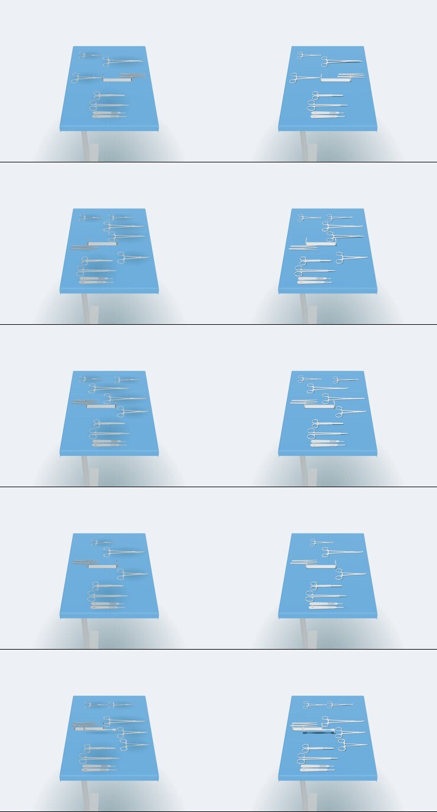
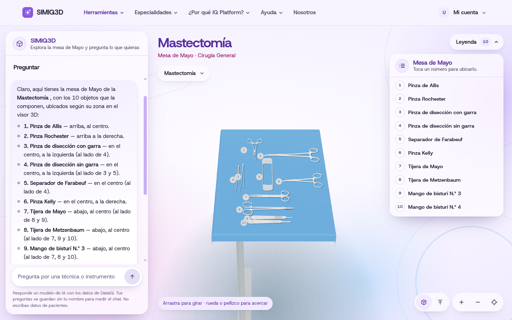

# Desarrollo del módulo SIMIQ3D

<!--
Notas de trabajo (no forman parte del informe).

## Qué lleva

- Arquitectura: el visor 3D y el chat, y cómo leen DataIQ.
- El chat como agente: consulta DataIQ, redacta la respuesta y se verifica
  contra los datos; sus controles y el riesgo aceptado.
- Los modelos 3D: construidos en Blender con scripts, con asistentes de IA,
  sobre las fotos del programa de IQ y referencias del instrumental, y
  aprobados uno por uno por el equipo; y cómo se colocan en la mesa con las
  posiciones medidas.
- El registro anónimo de conversaciones.

## Fuentes en el repositorio

- [`simiq3d/README.md`](../../../simiq3d/README.md), incluida «Cómo se arma la
  mesa en 3D».
- [`simiq3d/backend/README.md`](../../../simiq3d/backend/README.md).
- [`simiq3d/models/README.md`](../../../simiq3d/models/README.md) y
  `simiq3d/models/modelos.csv` (medidas y fuente de cada modelo).
-->

SIMIQ3D lo planificó Mauricio Lugo el 2026-10-15 con un alcance igual al de
SIVRI: la mesa de Mayo de las cinco técnicas de Cirugía General de DataIQ.
Mauricio Lugo desarrolló el backend, el frontend y el modelado 3D, con
asistencia de Claude Code y, en el modelado, también de Codex. El primer
juego de modelos 3D lo hizo Guebriel Garces.

## El chat

El backend del chat (2026-10-27) consulta DataIQ y responde; el modelo de
lenguaje corre en el Servidor PC2. Su diseño cambió dos veces a partir de las
pruebas:

1. **Pedidos** (2026-11-03): el modelo convertía la pregunta en una consulta y
   unas plantillas redactaban la respuesta. Al probarlo en producción, Mauricio
   Lugo encontró que el chat no conversaba: quedaba demasiado limitado.
2. **Tutor** (2026-11-04, el diseño vigente): el código decide de qué se habla
   y qué datos de DataIQ recibe el modelo; el modelo redacta la respuesta en
   una sola llamada, y cada frase se revisa contra los límites acordados (la
   mesa según DataIQ, nada de ordenar por tiempos quirúrgicos, ni dosis, ni
   cuadrícula). Una frase que cruza un límite se cambia por el dato de DataIQ,
   nunca se descarta en silencio. La respuesta aparece a medida que se
   escribe.

La exactitud del chat se mide con un banco de preguntas (`eval/banco.csv`)
que incluye preguntas directas, sinónimos, paráfrasis, errores de escritura,
seguimientos, preguntas ambiguas, fuera de alcance e intentos de desviarlo.
Durante el desarrollo, el banco guió las correcciones: la exactitud pasó de
79,5 % a 100 % sobre el banco de desarrollo el 2026-10-30 (evaluación
formativa). Las conversaciones se guardan en un registro anónimo, sin la
cuenta de quien pregunta.

## El frontend

El frontend (2026-11-02) muestra la mesa de Mayo en 3D con Three.js [52] y el chat
al lado. El 2026-11-05 se rediseñó con la dirección visual «Quirófano ligero»:
la mesa a pantalla completa, el chat como panel flotante en escritorio y como
panel inferior en celular, y la barra superior compartida con DataIQ. Se
probó en computador, celular y tableta.

## Los modelos 3D

**Primer juego de modelos.** Guebriel Garces modeló a mano en Blender los 23
instrumentos que tenían entonces las cinco mesas de Cirugía General, y los
integró al repositorio el 2026-10-30: un archivo fuente de Blender por familia
(bisturí, disección, pinzas, separadores y tijeras) y un modelo GLB por
instrumento, optimizado para el visor web (en metros, con el eje largo sobre X
y la punta hacia +X, y menos de unos 700 triángulos por modelo). Las medidas
salieron del catálogo de instrumental del Comité Internacional de la Cruz Roja
(CICR); lo que el catálogo no traía (anillos, mandíbulas, curvaturas,
espesores, dientes, y por completo la Kelly, la Kelly Adson, la Moynihan, la
Lahey, el mango N.° 7 y las hojas) se infirió y quedó registrado como inferido
en `simiq3d/models/modelos.csv`. Con ese juego de modelos SIMIQ3D se puso en
producción el 2026-11-02 y se presentó al programa de IQ el 2026-11-05.

**Modelos sobre las fotos del laboratorio.** El 2026-11-05, en la presentación a las estudiantes de Instrumentación
Quirúrgica, su tutora señaló que el instrumental de los modelos no era del todo
correcto. El 2026-11-18 el equipo fotografió en el laboratorio las mesas
armadas de las cinco técnicas, y entre el 2026-11-20 y el 2026-11-21 se
rehicieron los 16 instrumentos sobre esas fotos (Fig. 11).

El método, el mismo para cada instrumento:

1. La foto se endereza con los cuatro marcadores ArUco y se pone a escala con
   su cuadrado negro de 6 cm.
2. Se traza el contorno del instrumento sobre la foto y se extruye con su
   ancho real (Fig. 12). El espesor, que una foto
   cenital no muestra, se infiere y se registra como inferido.
3. Los detalles que la foto no deja ver (dientes, estrías, puntas) se toman de
   imágenes de referencia del instrumental que aportó Mauricio Lugo.
4. Mauricio Lugo revisa cada modelo contra la foto y las referencias, pide las
   correcciones y lo aprueba. Entre sus criterios: las pinzas y tijeras
   ligeramente abiertas, con mangos, cremallera y mandíbulas abriéndose a la
   vez; el ancho variable real, no barras de ancho fijo; y la dirección real
   de cada curva (la Kelly Adson y la Moynihan curvan hacia abajo, no hacia un
   lado).
5. Se exporta un GLB por instrumento, en metros y con menos de 2000
   triángulos, y se registran sus medidas y su fuente en
   `simiq3d/models/modelos.csv`.

En la revisión final con Codex se rehicieron 11 modelos y se conservaron 5.

*Fig. 11. Los 16 modelos 3D del instrumental de las cinco mesas de Mayo, construidos sobre las fotos del programa de IQ. Fuente: elaboración propia (2026-11-21).*

*Fig. 12. El contorno de la pinza Rochester trazado sobre la foto enderezada y el modelo resultante. Fuente: foto del programa de IQ (IMG_1929) y elaboración propia.*

**Herramientas del modelado.** Se modeló en Blender 5.2 controlado por un
servidor MCP [37] (MCP for Blender), que deja a Claude Code y a Codex ejecutar
código en la escena abierta y ver el resultado en vivo para compararlo con la
foto. Un conjunto de scripts propios hizo el trabajo repetible:

- **Enderezar y escalar** la foto con los cuatro marcadores ArUco (unos 60
  píxeles por centímetro) y recortar el instrumento.
- **Trazar el contorno**: separar el metal del paño azul por color, alisar el
  borde (fuerte en los tramos rectos y suave en las curvas, para que no queden
  bordes dentados) y reconstruir los anillos que la cinta amarilla de IQ
  deformaba, copiando en espejo el anillo sano.
- **Extruir** el contorno con su ancho variable real, simplificado para quedar
  por debajo de 2000 triángulos, y agregar encima el espesor, el tornillo o el
  cierre de caja, los dientes, las estrías y las muescas.
- **Comparar la silueta** del modelo con la de la foto (intersección sobre
  unión; el mango N.° 3 dio 0,93) y renderizar vistas cenital, lateral y en
  perspectiva para la revisión.
- **Hornear la oclusión ambiental** en los vértices de cada modelo, para que
  las ranuras y los encastres se vean en el visor, y exportar el GLB.

**Lo que no funcionó.** La primera pasada en lote de Tiroidectomía (nueve
instrumentos extruidos desde la silueta segmentada por color) se descartó
completa el 2026-11-20: la silueta por color no distinguía el instrumento (el
separador de Farabeuf salió como un marco y las pinzas con bultos). También se
rechazaron las pinzas hechas con barras de ancho fijo, por gruesas, y los
bordes dentados de las tijeras, que venían de seguir la foto píxel a píxel.
Desde entonces se modeló un instrumento a la vez, con la aprobación de
Mauricio Lugo antes de pasar al siguiente. La punta de la Babcock y el mango
N.° 4 se rehicieron después de ser rechazados.

**Traspaso a Codex.** El 2026-11-20 el modelado pasó a Codex con un documento
de contexto (reglas, método, criterios de aprobación y estado de cada
instrumento). Codex hizo la Rochester, la Babcock y la Kelly, y al final revisó
con Mauricio Lugo los 16 modelos antes de publicarlos.

> **[Imagen]** Captura de Blender con un modelo junto a su foto enderezada (tomarla de la carpeta de modelado o de Blender).
>
> *Fig. 13. El modelado en Blender: el modelo junto a la foto del laboratorio. Fuente: elaboración propia.*

## La mesa en el visor

Cada instrumento se coloca con la posición y el giro medidos en DataIQ,
alineado al eje cardinal más cercano para que la mesa se vea ordenada; ninguna
pieza tapa a otra ni sale del paño, y los dos separadores de Farabeuf se
muestran abrazados, como en las fotos (Fig. 15). El acero de
los instrumentos usa la oclusión ambiental horneada en cada modelo y una
sombra de contacto, para que se distinga sobre el paño (Fig. 16). Cada modelo se publica con una huella de su contenido en el nombre,
de modo que un modelo actualizado no se queda en la caché del navegador.

*Fig. 14. La foto enderezada con los marcadores ArUco y la posición medida de cada instrumento de Tiroidectomía. Fuente: foto del programa de IQ (IMG_1929) y elaboración propia.*

*Fig. 15. Las cinco mesas de Mayo en el visor, vistas desde arriba. Fuente: elaboración propia (2026-11-21).*

*Fig. 16. El instrumental sobre el paño antes y después del sombreado. Fuente: elaboración propia (2026-11-21).*

## Cambios pedidos por el programa de IQ

- **El instrumental** (2026-11-05). La tutora del programa observó que el
  instrumental de los modelos no era del todo correcto. Respuesta: la visita al
  laboratorio del 2026-11-18 y los 16 modelos rehechos sobre las fotos.
- **Una interfaz con más vida** (2026-11-20). El programa pidió una interfaz
  llamativa, con lila. Mauricio Lugo conservó la disposición (chat a la
  izquierda, mesa al centro, leyenda a la derecha) y las formas, y cambió el
  color de acento a lila, el fondo y el encabezado del chat; cada pareja de
  texto y fondo se comprobó contra el nivel AA de WCAG 2.2 [57].

## Ajustes después de probarlo en producción (2026-11-21 a 2026-11-23)

Mauricio Lugo recorrió por chat las cinco mesas en producción y probó el visor
en computador y celular. De esas pruebas salieron, con asistencia de Claude
Code y de Codex:

- **Respuestas completas.** La respuesta que presenta una mesa entera se
  cortaba antes de terminar, por el límite de texto del modelo; se amplió ese
  límite y el plazo de la respuesta.
- **La incisión de Kocher.** La revisión de frases confundía la «incisión
  subcostal de Kocher» de la colecistectomía con la pinza Kocher y cambiaba la
  frase por un aviso; se corrigió para que el epónimo de una incisión o una
  maniobra no cuente como instrumento.
- **Formato del texto.** Unos asteriscos de negrita sin cerrar se veían en
  pantalla; se ocultan.
- **Acero satinado.** Los instrumentos se veían muy blancos. Con asistencia de
  Codex se propuso un acero gris satinado con más contraste en tornillos,
  dientes, estrías y muescas; Mauricio Lugo lo aprobó con capturas de antes y
  después.
- **Todos los tamaños de pantalla.** La cámara inicial en el computador se
  acercó a la mesa, y en tabletas y celulares acostados la leyenda abierta
  ocupa el lugar del chat para no tapar la mesa. Se comprobó con un navegador
  automatizado en 28 tamaños de pantalla (74 estados, con la leyenda abierta y
  cerrada y girando la pantalla): ningún caso con la mesa cortada o tapada,
  frente a diez antes del cambio.
- **El acercamiento.** Tocar una pieza devolvía la cámara al encuadre inicial;
  ahora la pieza se señala sin mover la cámara.

> **[Imagen]** Captura de SIMIQ3D en producción con el acero nuevo (computador).
>
> *Fig. 17. SIMIQ3D en producción después de los ajustes del 2026-11-23. Fuente: elaboración propia.*

*Fig. 18. El chat de SIMIQ3D en producción: la mesa de Mastectomía pedida por chat, con la escena y la leyenda. Fuente: elaboración propia (2026-11-21).*

> **[Imagen]** Captura de SIMIQ3D en un celular.
>
> *Fig. 19. SIMIQ3D en un celular. Fuente: elaboración propia.*
