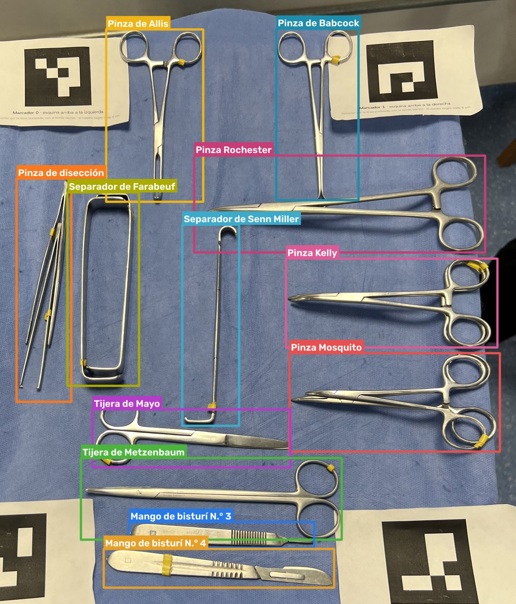
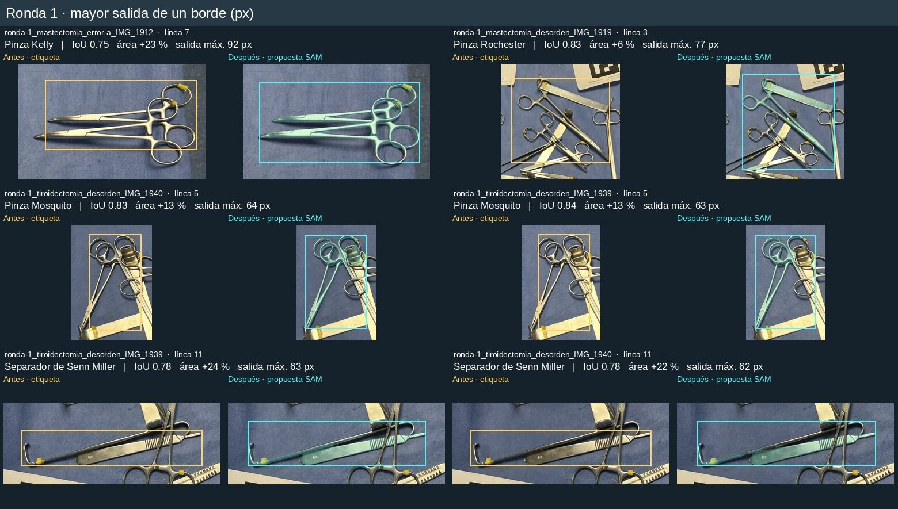
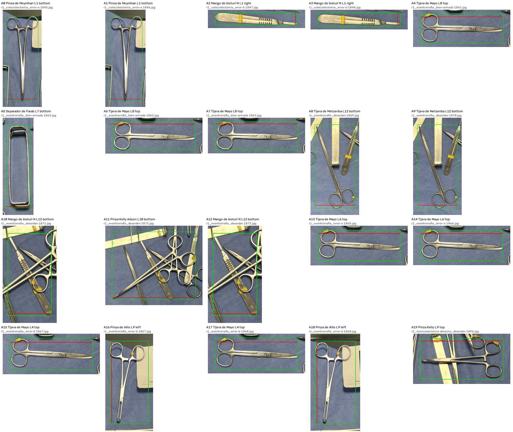
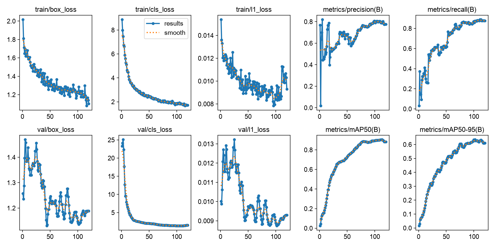
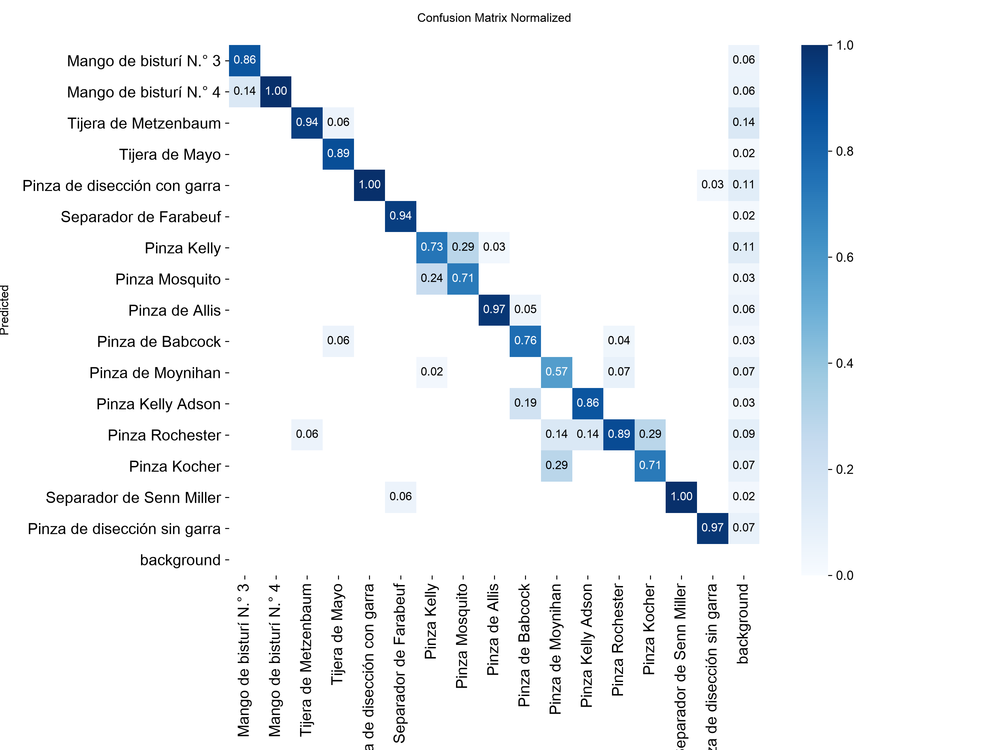
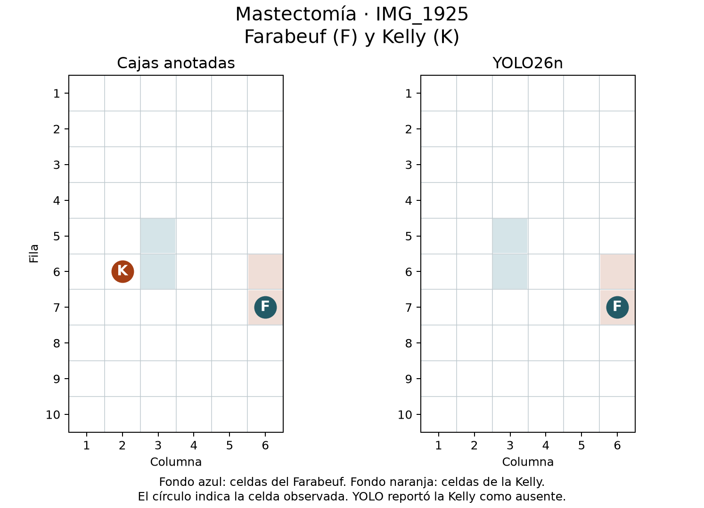

# Desarrollo del módulo SIVRI

<!--
Notas de trabajo (no forman parte del informe).

## Qué lleva

- Arquitectura: el backend en el Servidor PC1 y el detector YOLO.
- El dataset propio: protocolo de fotos, etiquetado y división por ronda.
- La lógica de validación de la mesa: cada instrumento en su celda, por el
  centro de su caja, con los marcadores ArUco.

## Fuentes en el repositorio

- [`sivri/README.md`](../../../sivri/README.md).
- [`sivri/docs/dataset.md`](../../../sivri/docs/dataset.md).
- [`sivri/backend/README.md`](../../../sivri/backend/README.md).
-->

SIVRI lo planificó Mauricio Lugo el 2026-10-13 con el alcance de la mesa de
Mayo de las cinco técnicas de Cirugía General y un dataset propio. Mauricio
Lugo desarrolló el backend, el dataset y el detector, con asistencia de Claude
Code y de Codex.

## Backend

El backend (2026-11-19) recibe la foto de la mesa (`POST /validate`) o un video
continuo (`WS /ws/validate`), detecta el instrumental con YOLO26 y valida la
mesa contra la técnica de DataIQ. Corre en el Servidor PC1 (decidido por
Mauricio Lugo el 2026-11-18). Cada clase del detector es un instrumento del
catálogo de DataIQ, mapeado por nombre o alias.

La validación es independiente del detector: los cuatro marcadores ArUco
[36] de las esquinas dan la cuadrícula de la mesa, cada instrumento se empareja con su
posición esperada (algoritmo húngaro) y se juzga por el centro de su caja, con
un margen en los bordes. El resultado dice qué falta, qué sobra y qué está mal
ubicado, con la zona de la mesa, los instrumentos vecinos y el número del
diagrama; nunca con filas ni columnas, porque la mesa real no tiene
cuadrícula.

## Dataset

El 2026-11-18 el equipo fotografió en el laboratorio las mesas de Mayo de las
cinco técnicas, en tres rondas, con los marcadores ArUco en las esquinas. En
cada ronda se fotografió la mesa bien armada, dos variantes con errores puestos
al azar y la mesa en desorden: 125 fotos en total (45 bien armadas, 30 con el
error A, 30 con el error B y 20 en desorden). La división respeta las rondas:
la Ronda 1 entrena (55 fotos), la Ronda 2 valida (35) y la Ronda 3 prueba (35).

**La visita al laboratorio.** La visita se programó para el 2026-11-17 y se
aplazó al 2026-11-18, en acuerdo con el programa. En el laboratorio de
simulación, las estudiantes de Instrumentación Quirúrgica armaron cada mesa de
Mayo con el instrumental del programa, sobre su funda azul, y cada mesa se
fotografió desde arriba con un celular, con cuatro marcadores ArUco impresos en
las esquinas. Las fotos (3024 × 4032 píxeles) y algunos videos se guardaron en
el Drive del proyecto, organizados por ronda, técnica y situación. Los errores
de las mesas A y B los pusieron las estudiantes al azar y no se registraron.
El programa entregó además las listas de instrumental de cada técnica, que
reemplazaron las mesas de los documentos anteriores (2026-11-19), y completó la
de Tiroidectomía con el mango N.° 4 y las dos pinzas de disección
(2026-11-20).

> **[Imagen]** Una foto de la mesa de Mayo bien armada del Drive (sin personas), por ejemplo Tiroidectomía, ronda 1.
>
> *Fig. 20. Mesa de Mayo de Tiroidectomía bien armada, fotografiada en el laboratorio con los cuatro marcadores ArUco. Fuente: programa de IQ y equipo del proyecto (2026-11-18).*

> **[Imagen]** Una foto «Error A» y una «Desorden» de la misma técnica, lado a lado.
>
> *Fig. 21. Las situaciones fotografiadas: mesa con errores y mesa en desorden. Fuente: programa de IQ y equipo del proyecto (2026-11-18).*

## Etiquetado y corrección de las cajas

**Cómo se trazaron las cajas.** Cada instrumento de cada foto lleva una caja y
su clase. Para no trazar las cajas (1487 en el dataset final) una por una sobre fotos tomadas en ángulo,
se trabajó sobre la foto enderezada: con los cuatro marcadores ArUco se
calcula una homografía que lleva la mesa a una vista cenital, donde los
instrumentos de una mesa tienen la misma forma en todas las fotos. Las cajas
se trazaron en una foto de cada montaje, se propagaron por correlación a las
fotos parecidas y se revisaron a mano las piezas que se habían movido; al
final, las cuatro esquinas de cada caja se llevaron de vuelta a la foto
original con la homografía inversa, que es la que ve el detector.

Las cajas se etiquetaron el 2026-11-19 con asistencia de Claude Code, de forma
semiautomática: en la foto enderezada con los marcadores, las cajas de una
foto se propagaron a las parecidas y se revisaron a mano las que cambiaban (Fig.
de las etiquetas de Tiroidectomía). La revisión del 2026-11-21 encontró dos
problemas, que se corrigieron:

1. **Los mangos de bisturí N.° 3 y N.° 4 estaban intercambiados** en las 125
   fotos. Se corrigieron con asistencia de Claude Code, con respaldo de las
   etiquetas anteriores.
2. **Algunas cajas no cubrían el instrumento entero.** Con asistencia de Codex
   se comparó cada caja del dataset con la máscara del modelo de
   segmentación SAM 2.1 [38] (Fig. 23). Con asistencia de
   Claude Code se ampliaron las 79 cajas en que el instrumento seguía por fuera
   del borde, sin achicar ninguna; Mauricio Lugo revisó las ampliaciones antes
   de aplicarlas (Fig. 24).

*Fig. 22. Las cajas etiquetadas de una mesa bien armada de Tiroidectomía. Fuente: foto del programa de IQ (IMG_1929) y elaboración propia.*

*Fig. 23. Revisión de las cajas con SAM 2.1: la caja vigente y la propuesta por la máscara. Fuente: elaboración propia (2026-11-21).*

*Fig. 24. Cajas ampliadas (en verde) donde la anterior (en rojo) cortaba el instrumento. Fuente: elaboración propia (2026-11-21).*

El 2026-11-21 Mauricio Lugo decidió separar la pinza de disección con garra y
la sin garra en dos clases, para que el detector las distinga, y asignar a cada
instrumento la celda donde cae su posición medida. Al probar el frontend con
las fotos «Bien armada» aparecían indicaciones de mover piezas bien puestas,
porque las celdas salían de una sola foto por técnica y el programa de IQ no
armó la mesa igual en cada ronda. El 2026-11-23 Mauricio Lugo decidió
recalcularlas con las fotos «Bien armada» de las tres rondas: cada instrumento
suma las celdas vecinas donde también se puso. Contando los centros de las
cajas anotadas de las tres rondas (466 centros), las indicaciones falsas de
mover bajaron de 49 a 18 (`sivri/backend/README.md`); los resultados por foto
de las rondas 2 y 3 están en la sección de resultados.
Ese mismo día se corrigió el reconocimiento de la técnica, que ahora descuenta
los instrumentos que sobran para cada una.

## Detector

La primera corrida (`sivri-r1`, 2026-11-19) entrenó YOLO26n en CPU durante 120
épocas, con entrada de 640 px. Como esa corrida usó las etiquetas con los
mangos intercambiados y las cajas cortas, el 2026-11-21 se completó `sivri-r2` con
1487 cajas, 16 clases y la misma división por ronda. Se eligieron los pesos
con la Ronda 2. Las dos disecciones tienen cajas individuales en las 125 fotos.
La receta fue la misma en todas las corridas: YOLO26n preentrenado, 120
épocas, imágenes de 640 píxeles, lotes de 8 y semilla fija, en la CPU de un
computador de escritorio, sin tarjeta gráfica; cada corrida tardó alrededor de
media hora. En cada corrida, la Ronda 3 se midió una sola vez, al terminar
el entrenamiento, y no intervino en la elección de los pesos. Pero se midió en las tres corridas (`sivri-r1`,
`sivri-r2` y `sivri-r3`), y la decisión de mantener `sivri-r2` se tomó viendo
la medición de la Ronda 3 de `sivri-r3`; por eso esa ronda sirvió también para
elegir entre corridas y sus cifras no son una prueba totalmente reservada.
Además, las tres rondas se tomaron en la misma visita al laboratorio y con el
mismo instrumental del programa: la división por ronda separa las fotos, pero
no equivale a sesiones independientes (otro día, otras personas, otro celular)
como se había planificado, y las métricas del detector pueden ser más
optimistas que las que obtendría con una sesión nueva.

*Fig. 25. Pérdidas y métricas por época del entrenamiento sivri-r2. Fuente: Ultralytics, elaboración propia (2026-11-21).*

*Fig. 26. Matriz de confusión normalizada de las 16 clases en la validación. Fuente: Ultralytics, elaboración propia (2026-11-21).*

En las mesas bien armadas, casi la mitad de los instrumentos que faltaban eran
pinzas de disección que el modelo sí veía, pero con una confianza menor que el
umbral de 0,35. El 2026-11-23 Mauricio Lugo decidió dar un umbral propio a los
instrumentos que el modelo ve con poca confianza, elegido en la Ronda 2 con
asistencia de Codex: 0,11 para la pinza de disección sin garra, 0,17 para la con
garra, 0,28 para el mango N.° 3 y 0,33 para la Kelly Adson; los demás conservan
0,35. Ese mismo día, con asistencia de Codex y de Claude Code, se revisaron las
etiquetas de la Kelly (una caja por pinza cuando las dos se distinguen en la
foto) y se entrenó una corrida de prueba, `sivri-r3`, con la misma receta. No
mejoró a `sivri-r2` en la Ronda 3 (mAP@0.5 de 0,885 frente a 0,887), así que se
mantuvo `sivri-r2`. Los errores que quedan son de clase: el modelo confunde la
Kocher y la Kelly Adson con la Rochester y los dos mangos entre sí, lo que pide
más fotos y no otro umbral.

Desde el 2026-11-23, el backend en el Servidor PC1 valida con el DataIQ de
producción, el mismo en que el estudiante inicia la sesión, y recibe las
fotos del frontend de SIVRI publicado en la plataforma.

## El frontend de SIVRI

Juan Caraballo diseñó y desarrolló el frontend de SIVRI, en Angular, y lo
publicó el 2026-11-23 bajo `/sivri/` en el mismo sitio de la plataforma, con
su propio proyecto de Vercel. Primero dibujó las pantallas en el Figma del
proyecto, en dos rondas, siguiendo el estilo de la página «Nosotros». Sus
decisiones de diseño (2026-11-22):

- **Computador o celular.** En el computador, SIVRI solo explica qué hace y
  muestra un código QR para abrirlo en el celular, porque la cámara del
  computador no ve la mesa desde arriba; la cámara se usa solo en el celular.
- **Cuándo se compara la mesa.** El botón «Ya armé la mesa» se activa cuando
  se ven los cuatro marcadores. Al pulsarlo, el resultado se fija cuando la
  misma técnica sale primera en cinco resultados seguidos.
- **Mientras arma.** SIVRI solo nombra lo que ve, con una etiqueta junto a
  cada instrumento, sin cajas ni colores.
- **El resultado.** Lo que está en su lugar no se marca; lo que hay que mover
  lleva su caja y una flecha punteada hacia donde va, y lo que falta y lo que
  sobra se listan con su lugar en la mesa. Si dos técnicas quedan muy cerca,
  la pantalla dice «Puede ser una de dos» y muestra las dos.
- **Sin el verde de la marca** en el contenido, para que el color quede solo
  para lo que hay que corregir.

El frontend manda a la API de SIVRI, por un WebSocket, unos dos cuadros y
medio por segundo de la cámara, reducidos a 640 píxeles en JPEG (unos 45 kB
y 248 ms de mediana de ida y vuelta por Tailscale Funnel, medido en el
Servidor PC1).

> **[Imagen]** Captura de la página de SIVRI en el computador, con el código QR.
>
> *Fig. 27. SIVRI en el computador: explica qué hace y lleva al celular. Fuente: elaboración propia.*

> **[Imagen]** Captura del celular mientras se arma la mesa (cámara con los nombres de los instrumentos).
>
> *Fig. 28. SIVRI en el celular mientras se arma la mesa. Fuente: elaboración propia.*

> **[Imagen]** Captura del resultado en el celular (por ejemplo, «En su lugar», «Falta» y «Mover»).
>
> *Fig. 29. El resultado de SIVRI en el celular. Fuente: elaboración propia.*

> **[Imagen]** Captura de los mockups de SIVRI en Figma (sección «SIVRI · Mockups»).
>
> *Fig. 30. Las pantallas de SIVRI diseñadas en Figma. Fuente: Juan Caraballo.*

## Pruebas con el frontend y ajustes (2026-11-23)

Con el frontend publicado, el equipo probó SIVRI desde el celular con las fotos
«Bien armada» del Drive. Aparecieron tres problemas, que se corrigieron el
mismo día con asistencia de Claude Code y de Codex:

1. **Indicaciones de mover piezas bien puestas.** Las celdas salían de una sola
   foto por técnica, y el programa no armó la mesa igual en cada ronda. Se
   recalcularon con las fotos de las tres rondas (ver «Etiquetado y corrección
   de las cajas»).
2. **«Puede ser una de dos» con una mesa bien armada.** Una Tiroidectomía (12 de
   13 instrumentos en su lugar) empataba con Mastectomía (9 de 10). El parecido
   de cada técnica ahora descuenta los instrumentos que sobran para ella.
3. **Faltantes que el detector sí veía.** Las pinzas de disección se detectaban
   con poca confianza; se fijó el umbral por instrumento (ver «Detector»).

*Fig. 31. Celdas esperadas y celdas observadas de dos instrumentos en una mesa de Mastectomía, con las cajas anotadas y con el detector. Fuente: elaboración propia (2026-11-22).*
