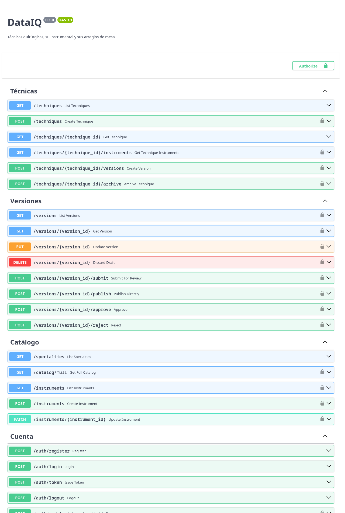
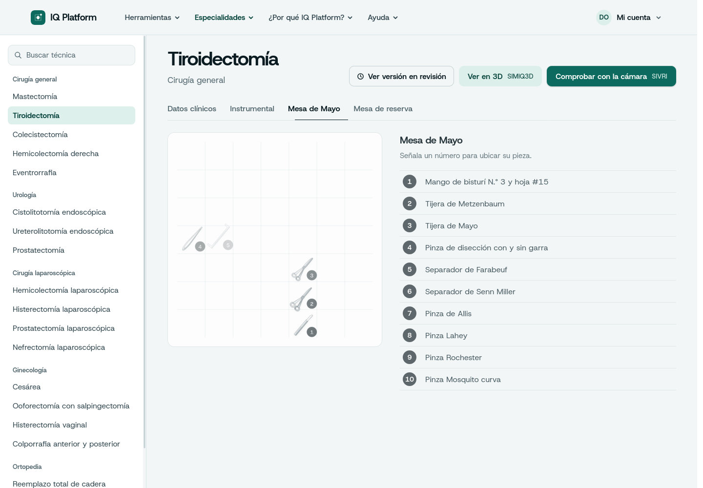
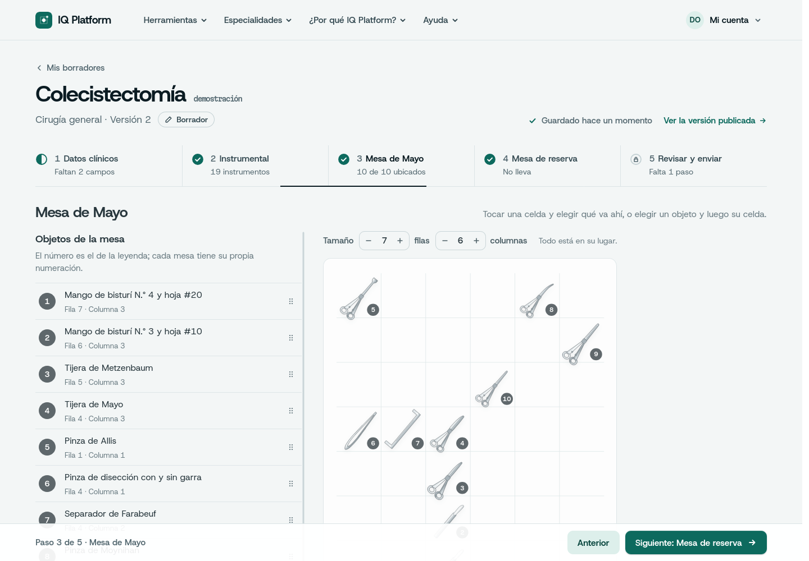
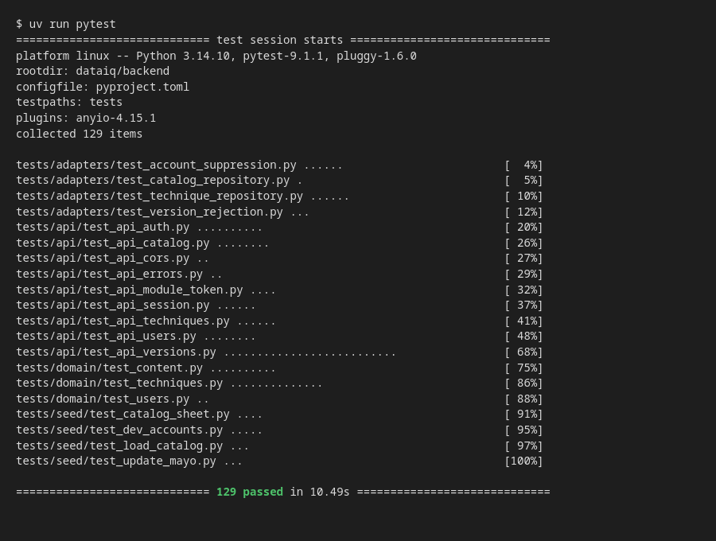

# Resultados de la implementación del desarrollo tecnológico

<!--
Notas de trabajo (no forman parte del informe).

## Qué lleva

- **DataIQ:** el dataset cargado (tabla de contenido), la API y la
  verificación con las pruebas automatizadas.
- **SIMIQ3D:** el visor con las cinco mesas de Mayo y la exactitud del chat
  sobre el banco de preguntas (respuestas correctas, respuestas inventadas,
  proporción entre el modelo y las plantillas) y el tiempo de respuesta.
- **SIVRI:** el detector (precisión, exhaustividad, mAP@0.5 y mAP@0.5:0.95,
  matriz de confusión y curvas de pérdida) y la lógica de validación sobre las
  mesas con errores puestos a propósito.
- **Evaluación con usuarios:** la SUS (meta de 68 o más) y el cuestionario
  tipo Likert de la prueba piloto.
- Capturas de cada producto.

## Fuentes en el repositorio

- Detector: [`sivri/docs/dataset.md`](../../sivri/docs/dataset.md),
  «Resultados del detector».
- Chat: [`simiq3d/backend/README.md`](../../simiq3d/backend/README.md) y los
  CSV del banco en [`../evidencias/`](../evidencias/).
- Las figuras: [`../figuras/`](../figuras/).
-->

Esta sección presenta los resultados en el orden de los objetivos
específicos. La primera tabla los resume; cada subsección presenta después el
resultado de un objetivo con su evidencia, y la última, el aporte del trabajo.
Los enlaces de acceso a los productos se encuentran en el Anexo C.

## Resultados por objetivo específico

La Tabla X resume qué se obtuvo para cada objetivo y
dónde se detalla.

**TABLA X. Resultados por objetivo específico**

| Objetivo | Resultado | Dónde se detalla |
|---|---|---|
| 1. Diagnóstico | Necesidad de los estudiantes del programa (no tienen cómo practicar y verificar la distribución del instrumental fuera del laboratorio), con tres estudiantes del programa y su docente tutora; delimitación en tres módulos y criterio de registrar la posición del instrumental y no su cantidad | Metodología y Anexo A |
| 2. Alcance | Matriz de registro de 18 técnicas de 5 especialidades, con el origen de cada dato; mesas de Mayo de las 5 técnicas de Cirugía General rehechas con las listas y las fotos del programa (57 objetos con posición medida) | DataIQ |
| 3. Diseño | Arquitectura hexagonal de tres módulos con DataIQ como fuente única por su API; modelo entidad-relación; sesión única con tokens firmados por DataIQ | Desarrollo de DataIQ y de la plataforma |
| 4. Desarrollo | DataIQ, SIMIQ3D y SIVRI en funcionamiento en la plataforma; 16 modelos 3D; dataset propio de 125 fotos y 1487 cajas; pruebas automatizadas en cada parte | DataIQ, SIMIQ3D y SIVRI |
| 5. Evaluación técnica | Detector: mAP@0.5 de 0,887 y mAP@0.5:0.95 de 0,614 en la prueba; técnica correcta primera en 60 de 64 fotos (con celdas definidas con las mismas fotos; no es una prueba independiente). Chat: 140 de 153 respuestas correctas (91,5 %), escena en 0,19 s y primer texto en 4,3 s. | Objetivo 5 |
| 6. Diseño de la prueba piloto | Prueba piloto diseñada: población, muestreo por conveniencia, sesión guiada, Escala de Usabilidad del Sistema, cuestionario tipo Likert de pertinencia pedagógica y consentimiento informado; se aplica cuando el programa presente la plataforma a sus estudiantes y docentes, después de la entrega | Metodología y Anexo E |

*Fuente: elaboración propia.*

## Objetivo 1. Diagnóstico

Las tres reuniones de trabajo con las tres estudiantes del programa y su
docente tutora (Tabla XVIII, Anexo A) establecieron la necesidad: los
estudiantes practican la distribución del instrumental en el laboratorio de
simulación, con el docente, y fuera de él no tienen cómo practicarla ni cómo
verificar si la mesa quedó bien. De las reuniones salieron dos decisiones que
orientaron el resto del trabajo: dividir el ecosistema en tres módulos (el
catálogo, la consulta fuera del laboratorio y la verificación en el
laboratorio) y registrar la posición de cada instrumento en la mesa y no su
cantidad, porque es el dato que el programa evalúa.

## Objetivo 2. Alcance

**Dataset cargado.** La Tabla XI resume el contenido de la base de
datos de DataIQ, contado el 2026-11-23 en `dataiq/backend/seed/tecnicas.xlsx`,
el archivo con que se carga DataIQ, y comprobado el mismo día contra el
catálogo de producción (`/catalog/full`), salvo el origen de cada dato, que la
API no expone. Las dieciocho técnicas tienen una versión publicada cada una.
Cada mesa y cada objeto conserva su origen, de modo que lo tomado del
documento de IQ, lo tomado de las fotos del programa, lo corregido y lo
propuesto pueden identificarse para su validación por el programa de
Instrumentación Quirúrgica. Frente al segundo corte cambiaron las mesas de
Mayo de las cinco técnicas de Cirugía General, rehechas con las listas y las
fotos de IQ (ver «Mesas de Mayo medidas en las fotos de IQ» en el desarrollo
de DataIQ); por eso cambian los objetos, sus componentes, las celdas y los
orígenes, y aparecen las filas de lo tomado de las fotos.

**TABLA XI. Contenido del dataset de DataIQ**

| Elemento | Cantidad |
|---|---:|
| Técnicas quirúrgicas | 18 |
| Especialidades | 5 |
| Instrumentos del catálogo | 146 |
| Categorías de instrumental (incluida «Sin clasificar», con 49 instrumentos) | 14 |
| Suturas | 52 |
| Suturas por técnica (cada sutura cuenta una vez por técnica, con todos sus planos) | 79 |
| Equipos biomédicos | 20 |
| Dispositivos médicos | 99 |
| Objetos en los arreglos de mesa | 478 |
| Componentes de los objetos | 558 |
| Celdas ocupadas en las mesas | 425 |
| Objetos tomados del documento de IQ | 259 |
| Objetos tomados de las fotos de IQ (2026-11-18) | 57 |
| Objetos corregidos con lo que el mismo documento aclara | 9 |
| Objetos propuestos para validación de IQ | 153 |
| Mesas tomadas del documento de IQ | 17 |
| Mesas tomadas de las fotos de IQ (2026-11-18) | 5 |
| Mesas propuestas para validación de IQ | 12 |
| Mesas marcadas como «no lleva» | 2 |

*Fuente: elaboración propia.*

## Objetivo 3. Diseño

El diseño se concretó en una arquitectura hexagonal de tres módulos, cada uno
con su backend y su base de datos, en la que DataIQ es la fuente única del
catálogo y los demás módulos lo leen solo por su API; en un modelo de datos
con técnicas versionadas, objetos de mesa con sus componentes y posiciones en
la mesa (Fig. 3); y en una sesión única, con tokens firmados por DataIQ
que los demás módulos validan con su clave pública. El tercer corte puso a
prueba ese diseño: SIMIQ3D y SIVRI se construyeron sin acceder a la base de
DataIQ, y cuando las mesas de Mayo cambiaron bastó con publicar una versión
nueva en DataIQ para que ambos la usaran.

## Objetivo 4. Desarrollo

Los tres módulos están en funcionamiento en la plataforma. DataIQ y SIMIQ3D
corren en la nube; SIVRI tiene su frontend en la plataforma y su backend en un
computador del equipo (el Servidor PC1).

**API.** Contada el 2026-11-23 con la documentación que genera la propia API,
tiene 24 rutas y 28 operaciones, en cinco grupos. Técnicas (6 operaciones)
permite consultar sin cuenta el catálogo de técnicas publicadas y los datos
clínicos de cada una y, con cuenta, su instrumental y sus mesas; además, crear
técnicas, crear versiones a partir de la publicada y archivar técnicas.
Versiones (8) permite consultar las versiones, editar un borrador, eliminarlo,
enviarlo a revisión, aprobarlo, rechazarlo con un motivo o publicarlo
directamente. Catálogo (5) ofrece el catálogo completo, las especialidades y
la consulta, creación y edición del instrumental. Cuenta (7) comprende el
registro, el inicio y el cierre de sesión, la consulta de la cuenta, la
emisión del token, el token corto con que SIVRI recibe la sesión y la
publicación de la clave pública con que los demás módulos validan los
tokens. Usuarios y roles (2) permite al administrador consultar las cuentas y
asignar roles. La documentación interactiva agrupa las rutas por tema.

*Fig. 32. Documentación interactiva de la API de DataIQ. Fuente: elaboración propia.*

DataIQ está en producción con el catálogo de técnicas, el instrumental y las
mesas. Las mesas de Mayo de las cinco técnicas de Cirugía General están
publicadas con la posición medida de cada instrumento en las fotos del
programa de IQ: 57 objetos con posición medida, en la versión publicada el
2026-11-21; el 2026-11-23 se publicaron sus celdas recalculadas con las fotos
de las tres rondas (ver el desarrollo de SIVRI). El catálogo se consulta sin
cuenta, por especialidad, y cada técnica muestra sus datos clínicos con la
fuente; con una cuenta se ven además el instrumental y las mesas, con el
diagrama numerado de la mesa de Mayo (Fig. 4, Fig.
5 y Fig. 6, en el desarrollo de DataIQ).

SIMIQ3D está en producción con el visor 3D y el chat. Los 16 instrumentos de
las cinco mesas se modelaron sobre las fotos del programa y cada mesa se arma
con las posiciones medidas en ellas; las figuras del desarrollo de SIMIQ3D
muestran los modelos, las posiciones medidas, las cinco mesas y la mesa de
Tiroidectomía en producción, con su leyenda, en la que cada instrumento se
elige por separado.

SIVRI está desplegado con su frontend en la plataforma: desde el computador
lleva al celular, y en el celular muestra la cámara mientras se arma la mesa
y después el resultado de la validación (ver las figuras del desarrollo de
SIVRI).

**Prototipos y frontend.** En el segundo corte se elaboraron nueve pantallas
navegables de la capa de navegación y de DataIQ, publicadas con un recorrido
por rol (Anexo C), entre ellas la consulta de la mesa de Mayo de una técnica,
con cada objeto en su lugar y su leyenda numerada, y el editor por pasos con
el que un colaborador ubica los objetos en la mesa. En el tercer corte el
frontend de DataIQ y el shell se construyeron a partir de esos prototipos
(ver «El frontend de DataIQ y el shell» en el desarrollo de DataIQ).

*Fig. 33. Prototipo de la consulta de la mesa de Mayo de una técnica. Fuente: elaboración propia.*

*Fig. 34. Prototipo del editor de la mesa de Mayo. Fuente: elaboración propia.*

**Verificación.** El sistema completo se probó sobre una base de datos vacía:
se creó el esquema con las migraciones, se cargaron las dieciocho técnicas y
se recorrió el flujo de registro, asignación de rol, consulta y publicación de
una versión nueva. En el entorno local, el catálogo completo, de unos 262 KB,
respondió en unos 29 milisegundos (medición del segundo corte). Además, cada
parte del sistema tiene sus propias pruebas automatizadas, que la integración
continua ejecuta en cada PR que toca ese módulo; las de los backends corren
contra una base PostgreSQL de prueba. La Tabla XII las resume, contadas
el 2026-11-23 con `pytest --collect-only` en los backends y con el ejecutor de
pruebas de cada frontend; en el segundo corte el backend de DataIQ tenía 69.

**TABLA XII. Pruebas automatizadas por parte del sistema (2026-11-23)**

| Parte | Pruebas | Qué cubren |
|---|---:|---|
| Backend de DataIQ | 129 | 26 de las reglas del dominio, 16 de los adaptadores, 72 de la API y 15 de la carga del catálogo |
| Backend de SIMIQ3D | 281 | 141 del dominio (el chat, la revisión de frases), 104 de los adaptadores y 36 de la API |
| Backend de SIVRI | 98 | 35 del dominio (la validación de la mesa), 33 de los adaptadores y 30 de la API |
| Frontend de DataIQ y shell | 2309 | Componentes, servicios y rutas |
| Frontend de SIMIQ3D | 130 | Componentes, el visor y el chat |

*Fuente: elaboración propia, a partir de las pruebas del repositorio.*

*Fig. 35. Ejecución de las pruebas automatizadas del backend de DataIQ. Fuente: elaboración propia.*

## Objetivo 5. Evaluación técnica

### Asistente conversacional de SIMIQ3D

**Exactitud del chat.** El 2026-11-21 el banco de 153 preguntas se corrió
contra el catálogo de producción de DataIQ, con el mismo modelo que usa
SIMIQ3D (Qwen3-VL 8B en Ollama), en el PC de desarrollo. Antes se
actualizaron 8 preguntas cuya respuesta esperada correspondía a las mesas
anteriores a las listas de IQ del 2026-11-19 (por ejemplo, instrumentos que ya
no van en ninguna mesa). Resultado: **140 de 153 respuestas correctas
(91,5 %)**. Ninguna respuesta tuvo frases sin respaldo en los datos de DataIQ
según la verificación automática, que compara nombres, números y ubicaciones
(no el sentido de cada frase). La revisión del tutor corrigió 60 frases en 36
respuestas antes de mostrarlas. El modelo no responde igual en cada corrida:
entre dos corridas seguidas, el resultado varió en unas tres preguntas.

Las 13 respuestas incorrectas se agrupan así: tres respuestas fuera de tema
que el modelo contesta en lugar de declinar (incluido un intento de hacerle
olvidar sus reglas); tres comparaciones entre mesas que nombran un
instrumento de más o de menos; tres preguntas por datos clínicos en las que
falta un dato o la aclaración de que DataIQ no tiene tiempos quirúrgicos; y
casos aislados (una pregunta ambigua sin pedir precisión, un error de
escritura, una explicación general y una pregunta sobre cómo ordenar la mesa).
El detalle de cada pregunta está en
[`../evidencias/banco-simiq3d-2026-11-21.csv`](../evidencias/banco-simiq3d-2026-11-21.csv).

**Tiempo de respuesta en producción.** El 2026-11-21 se hicieron 20 preguntas
al chat de producción, con el modelo en el Servidor PC2: cuatro por técnica
(mostrar la mesa, ubicar un instrumento, para qué sirve un instrumento y las
indicaciones de la técnica). La respuesta llega por partes, y se midieron tres
momentos:

**TABLA XIII. Tiempo de respuesta del chat de SIMIQ3D en producción (20 preguntas)**

| Momento | Mediana | Percentil 90 | Mínimo | Máximo |
|---|---|---|---|---|
| La orden de la escena (qué técnica abre y qué resalta) | 0,19 s | 0,22 s | 0,18 s | 1,01 s |
| El primer texto de la respuesta | 4,3 s | 5,4 s | 2,9 s | 7,1 s |
| La respuesta completa | 10,4 s | 19,6 s | 6,1 s | 21,3 s |

*Fuente: elaboración propia, a partir de `evidencias/tiempos-simiq3d-2026-11-21.csv`.*

La escena cambia casi de inmediato porque la decide el código con los datos
de DataIQ, sin esperar al modelo de lenguaje; el máximo de 1,01 s fue la
primera petición, que arranca el servicio. El texto empieza a aparecer a los
pocos segundos y se completa mientras se lee; las respuestas más largas son
las que presentan una mesa completa (entre 18 y 21 s). La medición llega hasta
la orden de la escena; dibujarla en el navegador suma la descarga de los
modelos 3D la primera vez. El detalle está en
[`../evidencias/tiempos-simiq3d-2026-11-21.csv`](../evidencias/tiempos-simiq3d-2026-11-21.csv).
Estas mediciones son anteriores al 2026-11-22, cuando se amplió el límite de
texto del modelo porque la respuesta que presenta una mesa completa se cortaba
antes de terminar; desde entonces esas respuestas llegan completas y tardan
más, y no se volvieron a medir en producción.

**Recorrido de las cinco mesas en producción.** El 2026-11-21 se pidió por
chat, con la cuenta de prueba y una conversación nueva por técnica, la mesa
de Mayo de cada una de las cinco técnicas de Cirugía General («Muéstrame la
mesa de Mayo de la …»). En las cinco, el visor abrió la mesa pedida y la
leyenda coincidió objeto por objeto, en número y nombre, con la mesa publicada
en DataIQ: 10 objetos en Colecistectomía y Mastectomía, 12 en Eventrorrafia y
Hemicolectomía derecha y 13 en Tiroidectomía. En el texto de las respuestas se
observaron dos fallas de forma y una de contenido: en Colecistectomía y
Eventrorrafia el modelo abrió una negrita sin cerrarla y la interfaz la
muestra como asteriscos, y en Hemicolectomía derecha nombró como «pinza de
Babcock (n.º 3)» al vecino de la pinza de Allis, que es la pinza Rochester. El
detalle está en
[`../evidencias/recorrido-simiq3d-2026-11-21.csv`](../evidencias/recorrido-simiq3d-2026-11-21.csv),
y la captura de Mastectomía en `figuras/simiq3d-chat-mastectomia.png`.

### Detector y validación de SIVRI

**Detección.** En el dataset corregido de 125 fotos y 1487 cajas, YOLO26n
se entrenó durante 120 épocas en CPU sobre las 55 fotos de Ronda 1. Los
pesos elegidos con las 35 fotos de Ronda 2 se evaluaron una vez sobre las
35 fotos de Ronda 3. En esta última ronda la precisión fue 0,794, la
exhaustividad 0,862, el mAP@0.5 0,887 y el mAP@0.5:0.95 0,614 (Tabla
XIV). Las disecciones con y sin garra obtuvieron AP@0.5 de 0,956 y
0,931 (Tabla XV). Las tres rondas se capturaron en la misma
visita, con el mismo instrumental, y la Ronda 3 también se midió con las
corridas `sivri-r1` y `sivri-r3`, de modo que estas cifras describen una
prueba reservada del entrenamiento pero no una sesión independiente. Las
curvas del entrenamiento y la matriz de confusión están en el desarrollo de
SIVRI.

**TABLA XIV. Métricas del detector YOLO26n por corrida**

| Corrida | Grupo (fotos) | Precisión | Exhaustividad | mAP@0.5 | mAP@0.5:0.95 |
|---|---|---:|---:|---:|---:|
| `sivri-r1` (2026-11-19) | Validación, Ronda 2 (35) | 0,781 | 0,834 | 0,862 | 0,616 |
| `sivri-r1` (2026-11-19) | Prueba, Ronda 3 (35) | 0,861 | 0,843 | 0,889 | 0,628 |
| `sivri-r2` (2026-11-21), adoptada | Validación, Ronda 2 (35) | 0,801 | 0,874 | 0,900 | 0,635 |
| `sivri-r2` (2026-11-21), adoptada | Prueba, Ronda 3 (35) | 0,794 | 0,862 | 0,887 | 0,614 |
| `sivri-r3` (2026-11-23) | Validación, Ronda 2 (35) | 0,832 | 0,854 | 0,892 | 0,628 |
| `sivri-r3` (2026-11-23) | Prueba, Ronda 3 (35) | 0,829 | 0,821 | 0,885 | 0,606 |

*Fuente: elaboración propia, a partir de `sivri/docs/dataset.md`. `sivri-r1`
usó las etiquetas con los mangos intercambiados y una sola clase de disección,
y `sivri-r3` cambió las etiquetas de la Kelly en las rondas 1 y 2: las tres
corridas no se comparan con las mismas etiquetas.*

**TABLA XV. Precisión media (AP) por clase de `sivri-r2`**

| Clase | AP@0.5 validación | AP@0.5:0.95 validación | AP@0.5 prueba | AP@0.5:0.95 prueba |
|---|---:|---:|---:|---:|
| Mango de bisturí N.° 3 | 0,979 | 0,544 | 0,959 | 0,577 |
| Mango de bisturí N.° 4 | 0,990 | 0,588 | 0,954 | 0,541 |
| Tijera de Metzenbaum | 0,991 | 0,687 | 0,896 | 0,672 |
| Tijera de Mayo | 0,975 | 0,771 | 0,987 | 0,674 |
| Pinza de disección con garra | 0,950 | 0,530 | 0,956 | 0,551 |
| Pinza de disección sin garra | 0,957 | 0,510 | 0,931 | 0,524 |
| Separador de Farabeuf | 0,989 | 0,655 | 0,993 | 0,778 |
| Pinza Kelly | 0,773 | 0,580 | 0,666 | 0,494 |
| Pinza Mosquito | 0,608 | 0,455 | 0,855 | 0,704 |
| Pinza de Allis | 0,981 | 0,774 | 0,942 | 0,738 |
| Pinza de Babcock | 0,818 | 0,599 | 0,813 | 0,588 |
| Pinza de Moynihan | 0,611 | 0,561 | 0,917 | 0,622 |
| Pinza Kelly Adson | 0,995 | 0,858 | 0,725 | 0,497 |
| Pinza Rochester | 0,943 | 0,743 | 0,913 | 0,627 |
| Pinza Kocher | 0,913 | 0,672 | 0,752 | 0,570 |
| Separador de Senn Miller | 0,924 | 0,639 | 0,933 | 0,675 |

*Fuente: elaboración propia, a partir de `sivri/docs/dataset.md`.*

Las clases más débiles en la prueba son la Kelly (0,666), la Kelly Adson
(0,725) y la Kocher (0,752), pinzas de forma parecida entre sí; la Mosquito y
la Moynihan varían mucho entre validación y prueba.

**Reconocimiento de la técnica.** SIVRI evalúa una foto cuando ve los cuatro
marcadores ArUco: en las rondas 2 y 3, 64 de las 70 fotos los tenían. Con el
detector, la técnica correcta quedó en primer lugar en 50 de esas 64 fotos en
el diagnóstico del 2026-11-22, y en 60 de 64 (30 de 31 en la Ronda 2 y 30 de
33 en la Ronda 3) el 2026-11-23, después de que el reconocimiento descontara
los instrumentos que sobran para cada técnica y de que las celdas de las cinco
mesas se recalcularan con las fotos «Bien armada» de las tres rondas (Tabla
XVI). Con las cajas anotadas a mano en lugar del detector, que
miden la lógica de validación sin los errores del detector, la técnica correcta
quedó primera en 60 y en 64 de las 64 fotos en las mismas fechas.

**TABLA XVI. Reconocimiento de la técnica en las fotos con los cuatro marcadores de las rondas 2 y 3**

| Ronda | Fotos | Correcta primera, detector, 22-11 | Correcta primera, detector, 23-11 | Dos técnicas mostradas, 22-11 | Dos técnicas mostradas, 23-11 | Correcta primera, cajas anotadas, 22-11 | Correcta primera, cajas anotadas, 23-11 |
|---|---:|---:|---:|---:|---:|---:|---:|
| 2 | 31 | 26 | 30 | 6 | 3 | 27 | 31 |
| 3 | 33 | 24 | 30 | 2 | 3 | 33 | 33 |
| Total | 64 | 50 | 60 | 8 | 6 | 60 | 64 |

*Fuente: elaboración propia, a partir de `sivri/backend/README.md` y
`evidencias/sivri-reconocimiento-2026-11-23.csv`. Las celdas del 23-11 se
definieron con fotos de estas mismas rondas: no es una prueba independiente.*

**Avisos en mesas bien armadas.** Una mesa bien armada no debería recibir
avisos. En las 26 fotos «Bien armada» evaluables (13 por ronda), con la técnica
fijada, el recálculo de las celdas bajó los avisos de mover de 24 a 6, pero
quedaron 45 avisos de faltante y 23 fotos con algún aviso (Tabla
XVII). Casi la mitad de esos faltantes eran pinzas de disección que el
detector sí veía, pero con una confianza menor que el umbral único de 0,35.
Con un umbral propio para los instrumentos que el detector ve con poca
confianza, elegido con la Ronda 2, los faltantes bajaron de 45 a 24 (en la
Ronda 3, medida una sola vez, de 20 a 15) y las fotos con algún aviso, de 23 a
18, sin detecciones falsas nuevas; los faltantes de las pinzas de disección
pasaron de 21 a 2.

**TABLA XVII. Avisos de SIVRI en las 26 fotos «Bien armada» evaluables, con el detector y la técnica fijada**

| Medida | Umbral único, celdas del 22-11 | Umbral único, celdas del 23-11 | Umbral por instrumento, celdas del 23-11 |
|---|---:|---:|---:|
| Avisos de mover | 24 | 6 | 6 |
| Avisos de faltante | 45 | 45 | 24 (Ronda 2: 9; Ronda 3: 15) |
| Avisos de sobrante | 0 | 0 | 0 |
| Fotos con algún aviso | 23 | 23 | 18 (Ronda 2: 10; Ronda 3: 8) |

*Fuente: elaboración propia, a partir de `sivri/backend/README.md` y
`evidencias/sivri-avisos-bien-armada-2026-11-23.csv`. Los umbrales por
instrumento se eligieron con la Ronda 2, que por eso no es una medición
independiente; la Ronda 3 se midió una sola vez.*

Las fotos son tomas repetidas de los mismos montajes, y las «Bien armada» de
las tres rondas se usaron para recalcular las celdas, de modo que estas
cifras miden la concordancia con esas referencias y no son una prueba
independiente. En las mesas con errores, los errores se pusieron al azar sin
registrarlos, así que no puede calcularse cuántos detectó SIVRI: por ejemplo,
en IMG_1925 (Mastectomía, error A) SIVRI ubicó el separador de Farabeuf fuera
de su zona tanto con las cajas anotadas como con el detector, pero no hay un
registro que diga si ese era el error puesto (ver Fig. 31 en el
desarrollo de SIVRI). La exactitud de los avisos frente al criterio de un
docente y la usabilidad con estudiantes quedan para la prueba piloto
diseñada (objetivo 6).

## Objetivo 6. Diseño de la prueba piloto

La prueba piloto quedó diseñada para aplicarse cuando el programa presente la
plataforma a sus estudiantes y docentes, después de esta entrega. El diseño
define la población (los estudiantes y docentes del programa de la CURN), el
muestreo por conveniencia con sus criterios de inclusión y exclusión, la
sesión guiada (explorar una mesa en SIMIQ3D y armar y validar una mesa con
SIVRI), los dos instrumentos —la versión en español de la Escala de
Usabilidad del Sistema, con la meta de 68 o más, y el cuestionario tipo Likert
de pertinencia pedagógica— y el consentimiento informado (Metodología y
Anexo E).

## Aporte del trabajo

El aporte del trabajo, con relación al problema planteado, es de cuatro
tipos. Primero, un artefacto: un ecosistema en producción que lleva la
consulta de la mesa fuera del laboratorio y una retroalimentación automática
dentro de él, sostenido por un catálogo en el que cada dato declara su origen.
Segundo, datos propios del programa: la matriz de registro de 18 técnicas, un
dataset de 125 fotos de mesas reales con 1487 cajas en 16 clases y 16 modelos
3D construidos sobre esas fotos, que no existían para este dominio. Tercero,
un procedimiento reproducible: fotografiar las mesas con marcadores
fiduciales para enderezarlas y medirlas, dividir los datos por ronda, modelar
el instrumental sobre las fotos y anclar las respuestas de un modelo de
lenguaje a una fuente verificable, revisando cada frase antes de mostrarla y
midiendo su exactitud con un banco de preguntas. Cuarto, un hallazgo: el
mismo programa no arma igual la misma mesa en cada ronda, de modo que una
validación automática necesita una tolerancia fijada por los docentes y no
una única posición correcta. Estos aportes son técnicos y metodológicos; el
efecto sobre el aprendizaje queda por medir con la prueba piloto.
